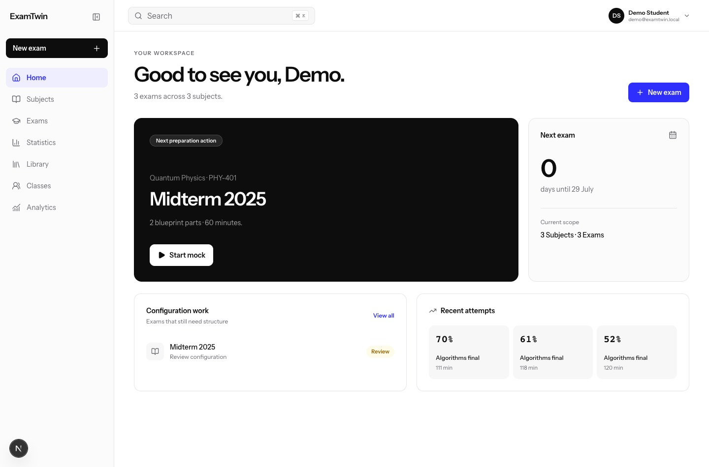
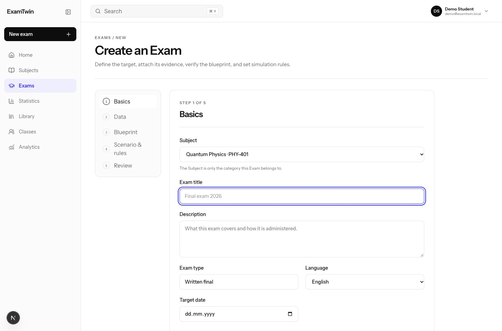
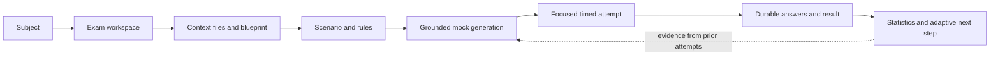
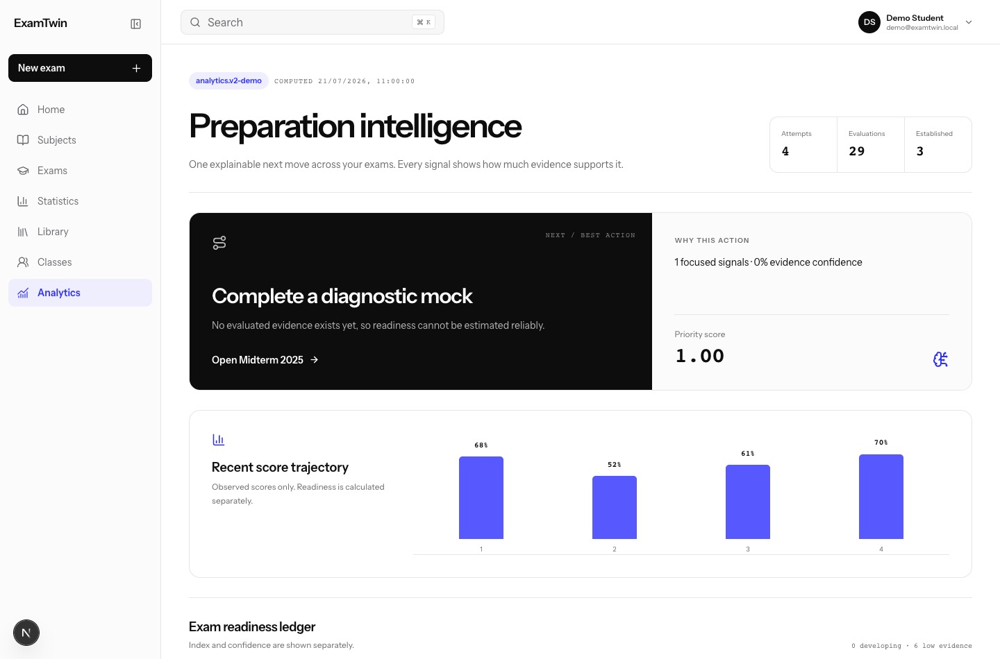
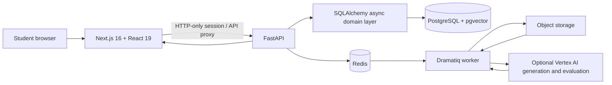

# ExamTwin

ExamTwin was built for OpenAI Build Week. A student adds course materials, defines how the real exam is structured and sits a timed practice exam. Earlier attempts show which skills need more practice and inform the next mock.

## Setting up and sitting a mock

An exam belongs to a subject. Its setup records the source material, question blueprint, timing and rules. A student can review these before starting a mock. During the session, the interface saves answers; the submitted attempt is kept for review.

The analytics screen shows previous attempts, evaluations and the evidence behind a suggested next step. Generated feedback is study guidance, not an official grade.

## System design

[Editable diagram](./system-design.excalidraw)

The Next.js app keeps the session in an HTTP-only cookie and proxies requests to FastAPI. SQLAlchemy stores subjects, exams, attempts and answers in PostgreSQL. Alembic versions the schema. Redis and Dramatiq support background processing for uploaded materials; the source also has a pgvector retrieval layer, object storage and optional Vertex AI generation and evaluation.

The screenshots come from the browser-only demo, which stores its fictional exam data locally. That run exercises the student interface and does not verify the external AI providers or the deployed backend. [Source repository](https://github.com/Rokki-Khazratov/OpenAI-buildweek).

[All case studies](../)
