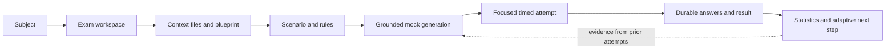
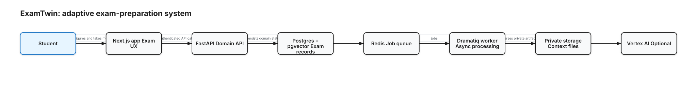
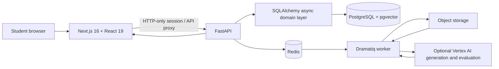
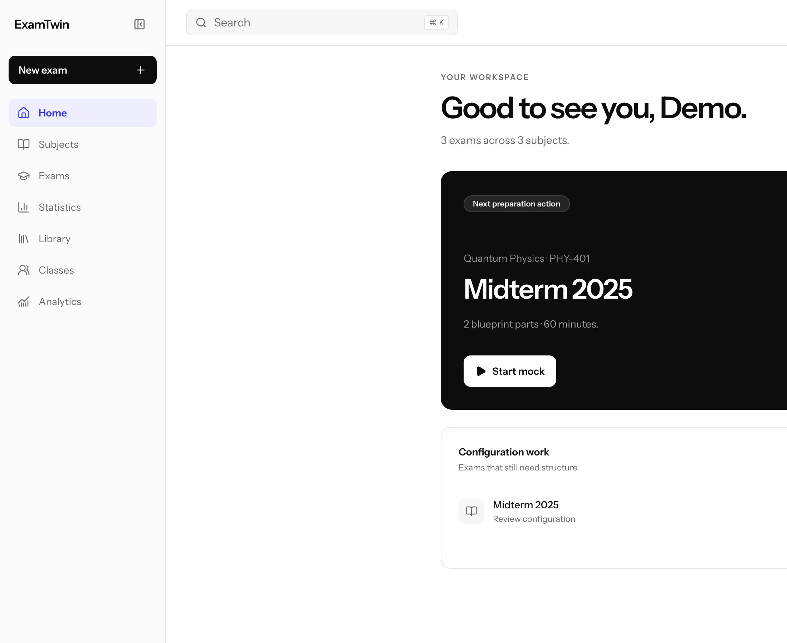
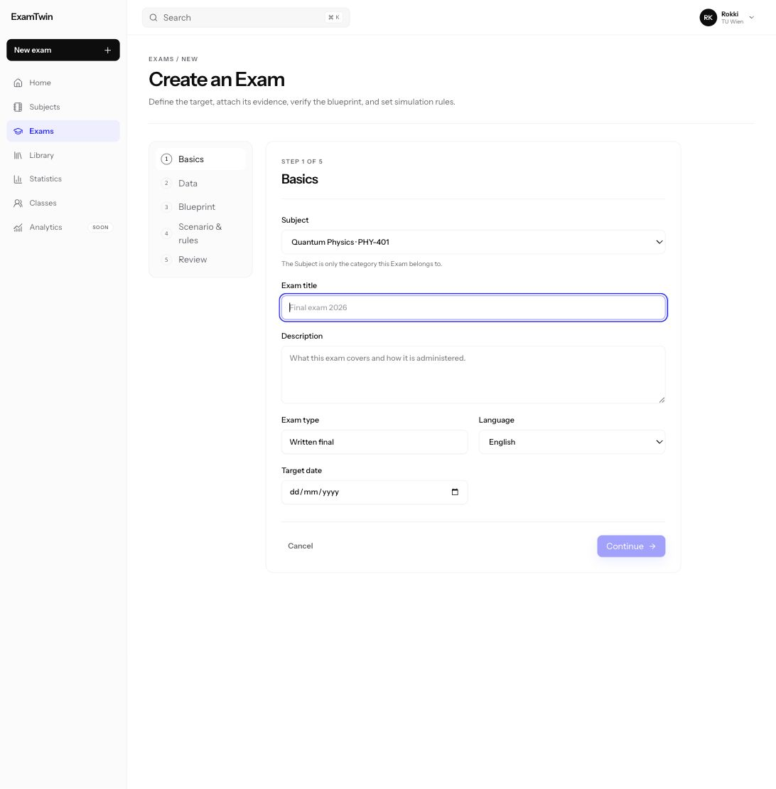
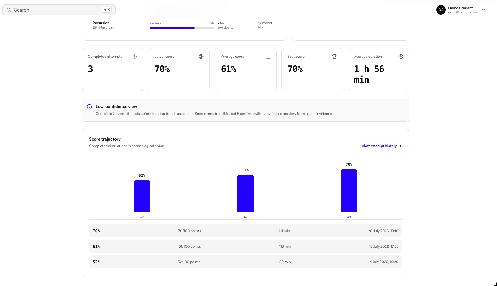

# ExamTwin

> Turn the material and rules that define a real exam into a realistic mock, then use each attempt as evidence for the next preparation step.

ExamTwin is an adaptive exam-preparation product built for OpenAI Build Week. It is organised around the exam rather than a generic question bank: a student creates a subject, defines one or more exams, attaches context, reviews the blueprint and rules, runs a timed mock, and retains attempts for later analytics and adaptation.

## Problem

Students often prepare from disconnected notes, past papers, rubrics and generic generators. Those tools can cover a topic but miss the constraints that determine performance: question types, section order, scoring, timing, allowed materials and grading rules.

## Product flow

## System design

The editable architecture source is [system-design.excalidraw](./system-design.excalidraw).

### Implemented boundaries

- **Frontend:** Next.js App Router product surface and focused exam-session layout.
- **API:** FastAPI ownership-protected CRUD, authentication, exam/attempt lifecycle and statistics endpoints.
- **Data:** PostgreSQL records and pgvector-ready retrieval layer; Alembic migrations version the schema.
- **Background work:** Redis and Dramatiq process artifacts with restart-safe retries.
- **AI mode:** Vertex-backed generation/evaluation is opt-in. A deterministic fallback keeps local development and CI reproducible.

## Verified local demo

The frontend has a local demo mode that runs without the backend and stores representative data in browser storage. The production frontend build passed locally on 2026-07-28.

| Screen | What it proves |
| --- | --- |
|  | Current exam context, next preparation action and recent-attempt history |
|  | Exam configuration is a structured workflow, not a single prompt |
|  | Performance evidence and trajectory can be inspected over time |

## Technical evidence

- Next.js 16 / React 19 / TypeScript / Tailwind CSS 4 frontend.
- FastAPI / Pydantic / SQLAlchemy asyncio backend.
- PostgreSQL 17 + pgvector, Alembic, Redis and Dramatiq worker.
- API surfaces include subject/exam CRUD, mock generation, durable attempts, response autosave, immutable submission and statistics.

## Privacy and boundaries

Uploaded study material is private by default. Generated feedback is study guidance, not an official grade. This case study intentionally excludes user documents, project credentials and deployment secrets.

## Contribution note

The final public wording of individual ownership and collaboration responsibilities will be added after a project-by-project factual review.
