# GeoAgro

### A nationwide orchard inventory, field-data and moderation platform

**Government agriculture platform · Uzbekistan · Web + mobile + REST API · Production**

GeoAgro turns field observations about orchards and vineyards into a controlled national dataset. District employees collect a farm's location, polygon, crops, photos and operational attributes in a mobile application. Regional leaders review the submission, republic-level administrators make the final decision, and the approved data becomes available through maps, registers, statistics and exports.

I joined the project as a backend engineer and later led the engineering work. My focus was the Django REST backend, the data and moderation model, access control, reporting, production operations and coordination with the React team.

**Backend Engineer → Team Lead · October 2024–March 2026 · Agro-Industry Development Agency**

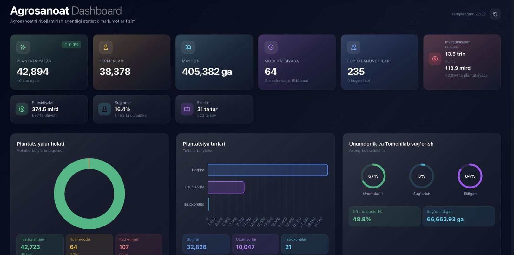

[Product walkthrough](#product-walkthrough) · [Workflow](#from-field-observation-to-approved-record) · [System design](#system-design) · [Engineering](#technical-implementation) · [Lessons](#review-and-lessons) · [Verification](./verification.md)

## Scale of the working dataset

The application was restored locally from a historical database snapshot. Direct counts from that isolated copy provide a concrete view of the system's scale:

| Entity | Rows in the restored snapshot |
| --- | ---: |
| Plantation records | **44,165** |
| Farmers and farming organizations | **38,378** |
| Polygon coordinate points | **627,689** |
| Plantation images | **98,678** |
| Plantation history entries | **498,287** |
| Crop-area records | **52,100** |
| Investment records | **74,456** |
| Varieties / fruit types / rootstocks | **323 / 31 / 90** |
| District reference records | **180** |

The project author reports deployment across Uzbekistan's 12 regions plus Karakalpakstan, with roughly 400 employee users and 30,000+ farmers represented in production. User and dashboard counts changed over the project's lifetime, so the table above is deliberately tied to one restored snapshot rather than presented as a current live metric.

## The problem

Agricultural inventory data had been assembled through spreadsheets and disconnected local processes. That made a nationwide answer difficult: where is a garden, what grows there, how much land is planted, who submitted the record, who approved it, and what changed afterward?

The challenge was also organizational. Data originates in districts, but it must be reviewed at regional and republic levels. A corrected record cannot silently replace the previously approved version. A deletion should remain traceable. Statistics must respect the same geography and approval rules as the operational register.

GeoAgro creates one chain from evidence collected in the field to an approved, reviewable record. It gives each level of the organization a workspace matched to its responsibility and gives central users an interactive geographic view instead of another static spreadsheet.

## My role

I designed and developed core backend capabilities with Python, Django REST Framework and PostgreSQL, then moved into the team-lead role. My work included API and data-model decisions, role-based access, staged moderation, reporting endpoints, background operations, deployment with Docker/Nginx/Gunicorn, database backups and coordination of integration with the React frontend.

The inspected backend contains API surfaces for plantations, farmers, geography, fruit data, images, moderation, statistics, reports, notifications and administrative operations. The web and Flutter applications were team deliverables; I do not present them as solo work.

## Product walkthrough

### One operational view for the republic

The home screen summarizes plantations, farmers, land area, moderation queues, user activity and investment information. Region and fruit distributions help administrators move from a national total to the part of the dataset requiring attention.

The preserved screenshot shows one historical application state. Its visible totals differ from the raw snapshot counts because dashboard queries apply status and business filters.

### Geographic inventory instead of spreadsheet coordinates

Users can move from Uzbekistan to a region, district and individual plantation. The district view overlays registered polygons on satellite imagery and keeps the corresponding plantation list beside the map. Selecting an object opens its operational card.

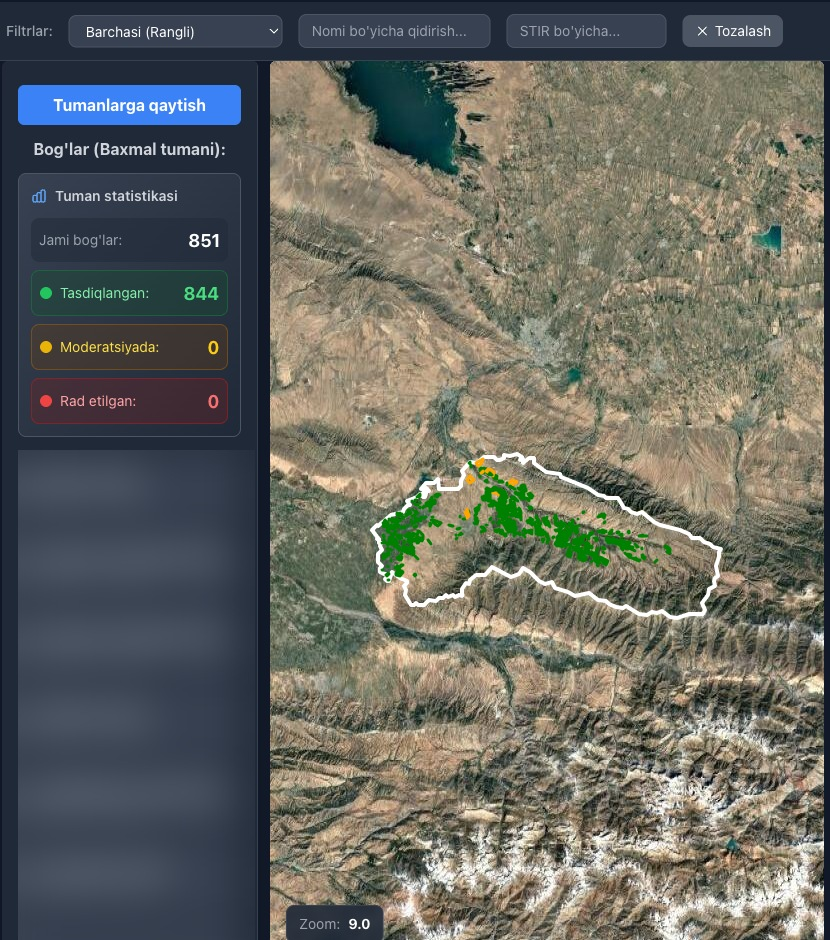

*Bakhmal district: a satellite view links field polygons to the district's inventory. Record names are obscured in this portfolio image.*

The backend stores each contour as ordered latitude/longitude points. This version does not depend on PostGIS: Python services handle distance and polygon calculations, while the React interface renders the result with Leaflet. The restored snapshot contains more than 627,000 coordinate points, so response shape and geographic scoping matter as much as the map component itself.

### A plantation is a structured operational record

A record brings together the farm, district, contour, total and planted areas, land and irrigation attributes, crops, varieties, planting years, investment, subsidies, infrastructure, photos and moderation state. Related history and comments explain how the current state was reached.

Crop areas are modeled separately because a single contour can contain several fruits or varieties. Reference catalogues for fruit types, varieties and rootstocks make that information reportable across districts instead of leaving it in free-form text.

### Regional and crop statistics from the same records

Statistics can be grouped by region, district and crop, filtered by planting or creation year, and exported to Excel. The backend calculates approved-only views and distinguishes total, planted, irrigated and unused areas. Farmer totals use unique identifiers rather than counting every plantation row as a separate farm.

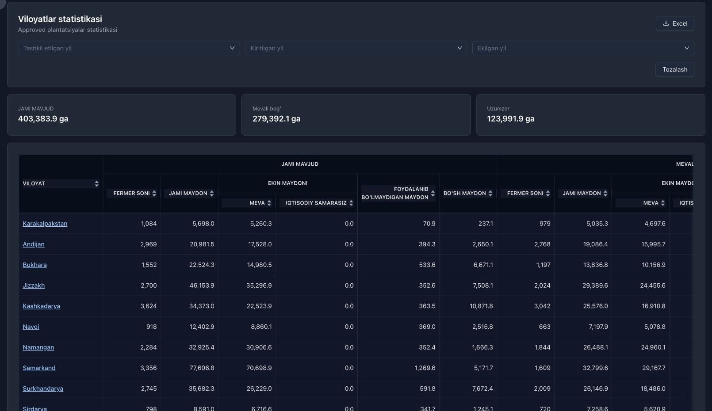

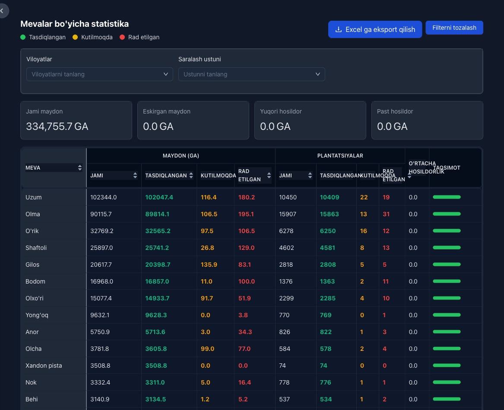

Drill-down pages preserve the geographic hierarchy and expose district totals inside a selected region.

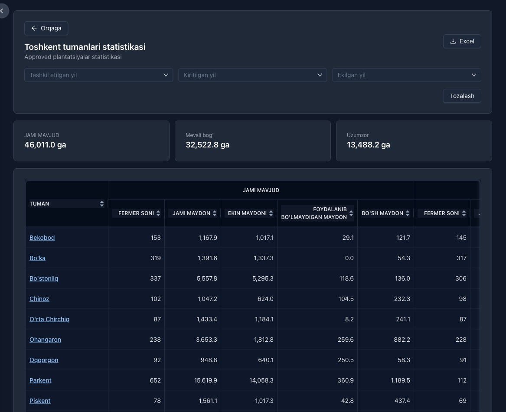

### Moderation is a workflow, not a boolean flag

A newly submitted record enters the regional queue. A regional head can review records from that region and either advance or reject them. Republic-level users see submissions that have passed regional review and make the final decision. The queue exposes the operation type, current stage and relevant record context.

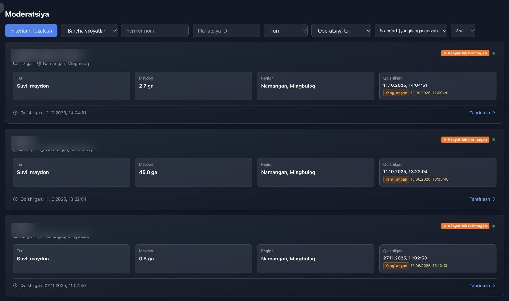

*The queue exposes geography, area, timestamps and review stage without requiring access to the underlying database. Record names are obscured here.*

Editing an approved plantation creates another controlled review cycle. The backend stores the previous data before the edited version enters moderation. Approval accepts the new state; rejection restores the prior approved state. This prevents an ordinary edit from bypassing the control applied during initial registration.

Deletion follows the same principle. A user submits a deletion request, moderators review it, and an accepted request archives the plantation rather than erasing its history.

### Administration and operational visibility

The web administration area manages regions, districts, users, fruit catalogues, investments, subsidies and infrastructure reference data. It also exposes recent operations and moderation activity.

Performance and log views help operators inspect request behavior and recent activity without direct database access.

The Django administration and interactive API documentation remain available for controlled technical operations.

More operational screens: deletion requests, administration, authentication and API

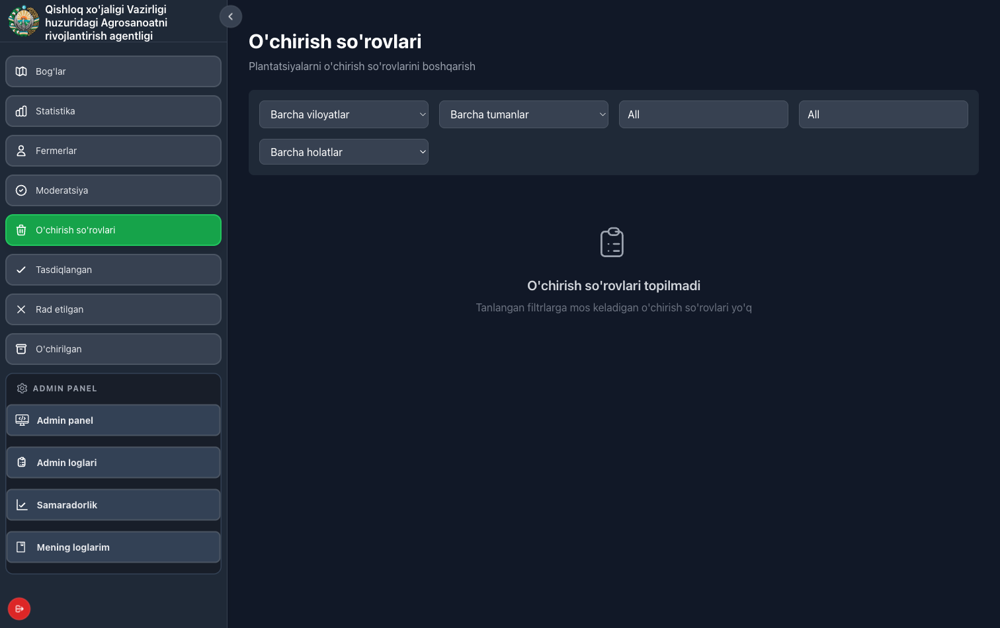

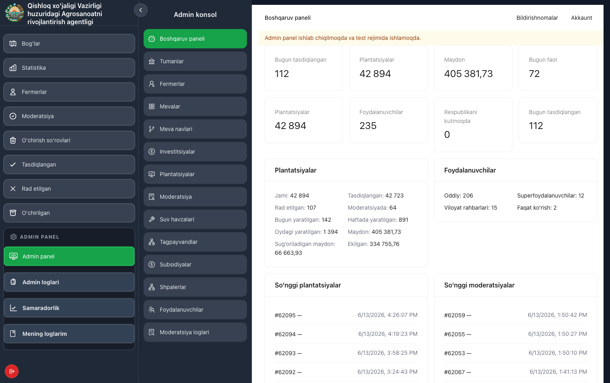

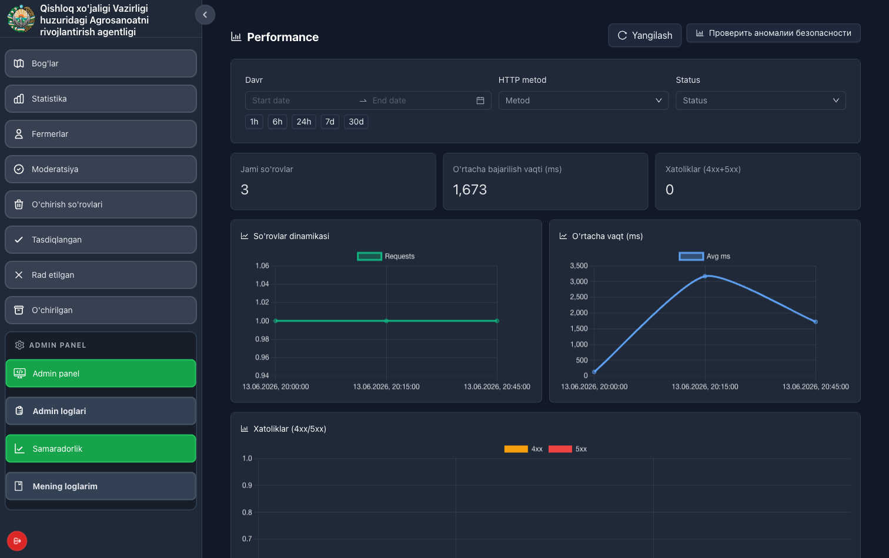

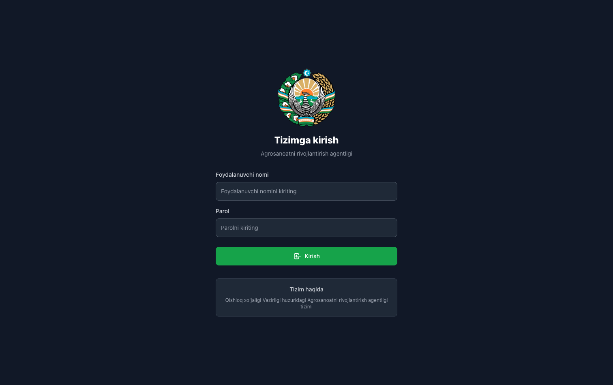

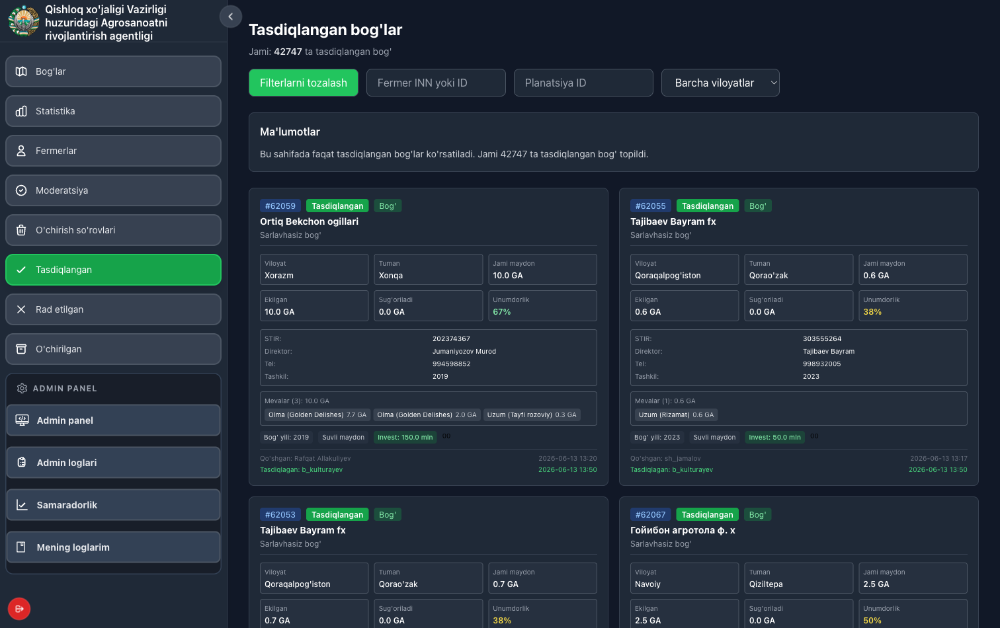

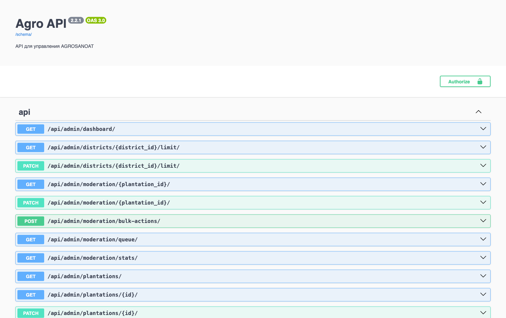

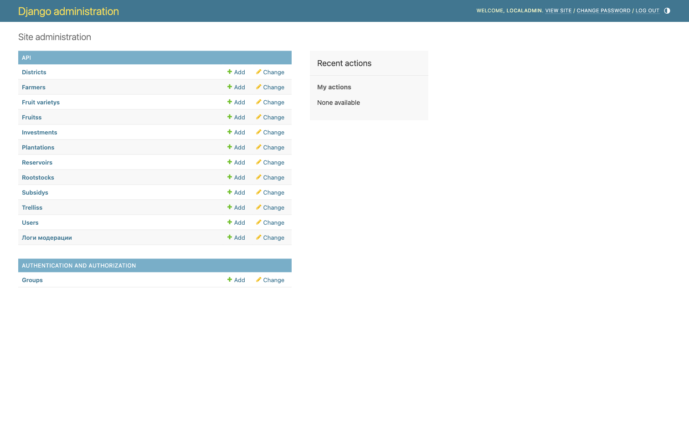

## From field observation to approved record

The working process has three organizational levels:

1. **District field employee.** Creates or updates a plantation in the mobile application, records its location and polygon, fills the agricultural and economic fields, and attaches the required photos.
2. **Regional head.** Reviews submissions for the assigned region, checks their context and either forwards or rejects them.
3. **Republic administrator.** Performs the final review and makes approved data available to registers, maps and official statistics.

The Flutter client supports authenticated district-scoped work, searchable plantation lists and a multi-step capture flow. Its form covers farm identity, coordinates, crops, varieties, rootstocks, planting schemes, irrigation, investment, infrastructure and subsidies. Photo requirements vary with the record composition, and the client blocks incomplete submissions.

Special field-user rules can restrict operations by distance from the user's recorded location. Server-side permissions then apply district, region or republic scope independently of the interface.

## Main features

| Area | Implemented behavior |
| --- | --- |
| Field inventory | Mobile creation and update of plantation records with GPS, contours and photo evidence |
| Geographic navigation | Republic, region, district and plantation views with satellite polygons |
| Structured agriculture data | Farms, crop areas, fruit types, varieties, rootstocks, planting years and schemes |
| Operational attributes | Irrigation, land condition, fertility, investment, subsidies, trellises, reservoirs and wells |
| Staged approval | District submission, regional review and republic-level final decision |
| Controlled updates | Previous-state snapshot and repeat moderation for edits to approved records |
| Controlled deletion | Moderated request followed by archival instead of silent physical deletion |
| Access control | District, region, republic and read-only roles enforced by the API |
| Statistics | Geographic and crop aggregations, filters, totals and Excel exports |
| Accountability | Actor attribution, moderation logs, comments and detailed before/after history |
| Operations | Administrative console, request logs, health/report endpoints and backup-oriented deployment |
| Notifications | In-app events, Firebase Cloud Messaging for the mobile application and Telegram management reports |

## System design

The architecture is documented through three connected views. Color is consistent across them: green marks field and approved data, cyan marks transport and data movement, violet marks governance, amber marks analytics and reporting, and red marks rejected or reversible transitions. Every source file is an editable Excalidraw scene rather than a flattened illustration.

### 1. Production system landscape

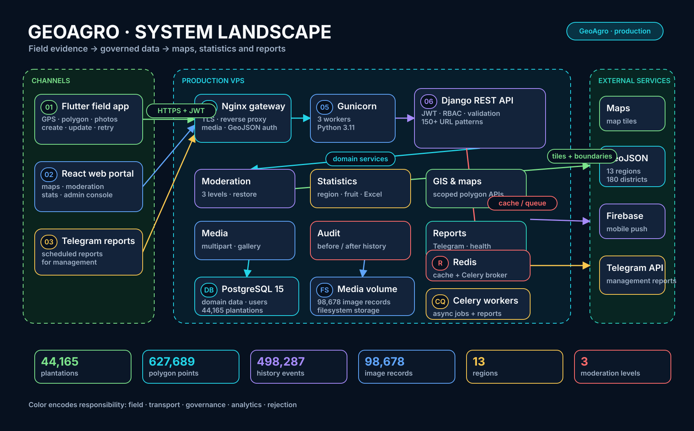

[Download the interactive HTML preview](./system-architecture-preview.html) · [Download the editable Excalidraw scene](./system-architecture.excalidraw)

District employees collect GPS coordinates, polygons, agricultural attributes and photos in the Flutter application. The React portal provides moderation, administration, maps and statistics, while Telegram delivers additional management reports. On the production VPS, Nginx terminates and routes requests to Gunicorn and the Django REST API. PostgreSQL stores the operational dataset and audit history; a media volume holds plantation evidence; Redis supports caching and Celery brokering; Celery workers run asynchronous jobs and reports. The system integrates with map tiles and GeoJSON boundaries, Firebase Cloud Messaging and the Telegram API.

The diagram deliberately keeps domain services inside one deployed Django application. Moderation, statistics, GIS, media, audit and reporting are logical responsibility boundaries in the inspected code, not claims that GeoAgro is deployed as microservices.

### 2. Three-level moderation engine

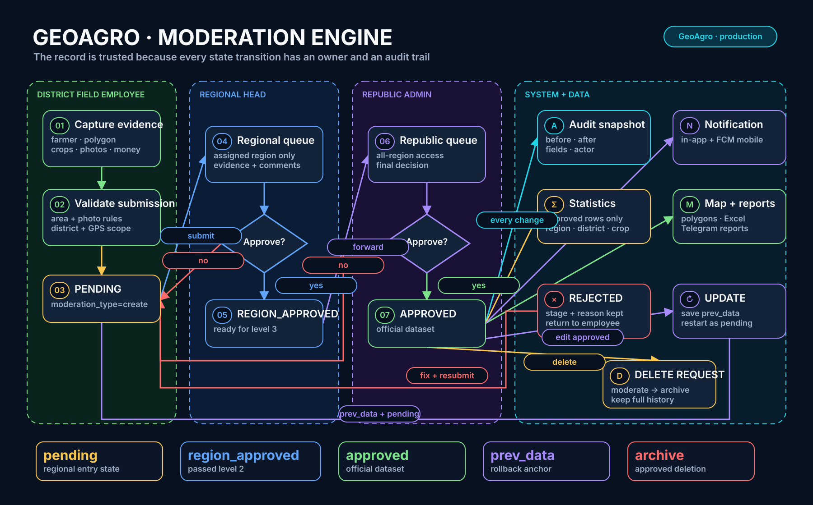

[Download the interactive HTML preview](./moderation-workflow-preview.html) · [Download the editable Excalidraw scene](./moderation-workflow.excalidraw)

The workflow follows the record from district evidence capture through `pending`, regional review, `region_approved` and the republic-level `approved` state. Every decision writes audit context and can generate a notification. Only approved rows feed official maps, statistics and exports.

Updates and deletions remain governed operations. Editing an approved plantation saves `prev_data` and restarts moderation; a rejection can restore the accepted version. An approved deletion request archives the record while preserving its history. These branches are central to the design because they prevent a later edit from bypassing the controls applied during initial registration.

### 3. Domain and data model

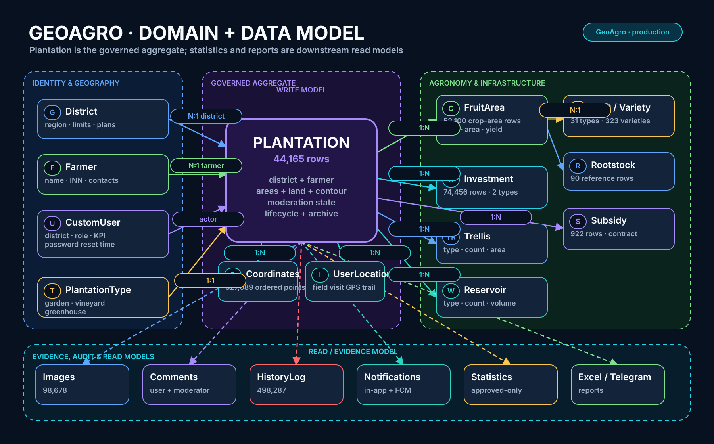

[Download the interactive HTML preview](./data-model-preview.html) · [Download the editable Excalidraw scene](./data-model.excalidraw)

`Plantation` is the governed aggregate. It connects geography, the farmer or organization, ownership and lifecycle state with ordered coordinates and field-visit locations. Agronomy and infrastructure live in related records such as `FruitArea`, `Investment`, `Subsidy`, `Trellis` and `Reservoir`, supported by controlled fruit, variety and rootstock catalogues.

Evidence and read models sit downstream from that write model. Images, comments and `HistoryLog` explain the record; notifications distribute state changes; approved-only statistics, Excel exports and Telegram reports turn the same source of truth into operational views. The restored snapshot makes the consequences tangible: **44,165** plantation rows connect to **627,689** polygon points, **98,678** image rows and **498,287** history events.

## Technical implementation

| Layer | Technologies verified in the inspected project |
| --- | --- |
| Web | React 18, React Router, Ant Design, Leaflet, Chart.js, Create React App |
| Mobile | Flutter, Dart, Dio, Riverpod, Google Maps integration, Firebase Cloud Messaging |
| API | Python, Django 4.2, Django REST Framework, JWT authentication |
| Data | PostgreSQL; relational domain model plus JSON snapshots for controlled changes; Redis cache and Celery broker |
| Geospatial work | Latitude/longitude records, geopy/pyproj calculations, GeoJSON boundaries |
| Delivery | Production VPS, Docker, Gunicorn, Nginx, Celery workers and PostgreSQL backup procedures |
| Integrations | Map tiles, GeoJSON boundaries, Firebase Cloud Messaging and Telegram reporting API |
| API tooling | OpenAPI/Swagger documentation and Django administration |

### Permissions follow geography

The API does not rely on hidden menu items for security. Ordinary users are limited to their district, regional heads to their region, and republic administrators can work across the dataset. Map and moderation endpoints apply those scopes when forming querysets. Read-only users receive a separate permission profile.

JWT payloads include a timestamp tied to password changes. Resetting a password therefore invalidates tokens issued against the previous credential state instead of leaving all sessions valid until natural expiry.

### History is part of the domain model

Plantation changes produce history entries with old values, new values, changed fields, the actor and the operation. The restored snapshot contains almost half a million such rows. Moderation logs and comments provide a second view focused on decisions, while `prev_data` supports the update-and-restore workflow for already approved records.

### Validation protects report quality

The API checks numeric ranges and relationships such as non-negative areas, irrigated area within the relevant total, fertility bounds and crop-area consistency. Polygon handling closes incomplete rings before area calculation. These checks keep invalid field input from becoming an apparently precise national statistic.

### Reporting reuses the operational source of truth

Statistics and Excel endpoints query the same approved records used by the map and register. Separate report endpoints support daily and date-range summaries, agriculture, investment and health views. A protected bot-facing interface allows an authorized reporting client to request those summaries without exposing the administrative API.

## Engineering challenges

**Preserving trust across organizational levels.** Approval could not be represented by one editable checkbox. The implementation makes stage, responsible scope, rejection point and operation type explicit, and applies moderation again when an approved object changes.

**Representing mixed field evidence.** A plantation combines a polygon, multiple crop areas, many photos and changing economic attributes. Splitting these into related records keeps the core entity manageable while retaining the evidence needed for review and reporting.

**Serving map and statistical views over a large relational snapshot.** A map does not need the same payload as a detail page. Dedicated endpoints return scoped geographic data, while aggregate services build region, district and fruit summaries. This separation avoids serializing the entire domain graph for every screen.

**Keeping old data explainable.** Archival, before/after history and previous-state restoration preserve what happened after a field record was first approved. That is essential in a system where a correction can alter official totals.

**Turning domain rules into one shared API.** Web administrators and field employees use different interfaces, but both act on the same business states. Server-side validation and permissions prevent those clients from developing contradictory versions of the workflow.

## Review and lessons

GeoAgro's strongest feature is the connection between field evidence and national visibility. The map is useful because every polygon leads back to a structured record; the statistics are useful because those records passed an explicit review process; the history is useful because approval does not make later changes invisible.

The project taught me to treat workflow and data lineage as architecture concerns. Roles, stages, restoration rules and archives must be present in the model and API, not added as labels after the database is designed. It also reinforced the value of designing endpoints around a screen's actual data shape, especially for geographic and aggregate views.

The inspected system also shows areas I would improve in a new iteration. Several responsibilities accumulated in a large Django application as the domain expanded. I would formalize service boundaries for moderation, statistics, media and reporting earlier, add migration checks against a completely empty database to CI, and define operational metrics for response time and moderation throughput. Those changes would make the next scale step easier without discarding the proven workflow.

## Verification and evidence

The original dark React frontend, Django backend and a separate PostgreSQL clone were started locally. Authentication, dashboard, moderation, statistics, maps, plantation detail, deletion requests and administrative routes were exercised against restored data. Source and documentation for the Flutter client were inspected separately.

No source code, credentials, personal phone numbers or detailed farmer identifiers are published in this repository. Screenshots are retained as historical product evidence; database counts are aggregate queries against the isolated snapshot.

The repository's clean-database test run exposed a legacy integer-to-JSON migration cast. The migration was corrected in the isolated review copy with an explicit PostgreSQL `to_jsonb` conversion before targeted workflow tests were rerun. **26 of 27 checks passed**; the remaining test uses an object whose in-memory `total_area` is stale after a related-record recalculation, so its supposed no-change PATCH actually sends a different value. See [verification notes](./verification.md) for the evidence boundary.

[← All portfolio case studies](../README.md)
