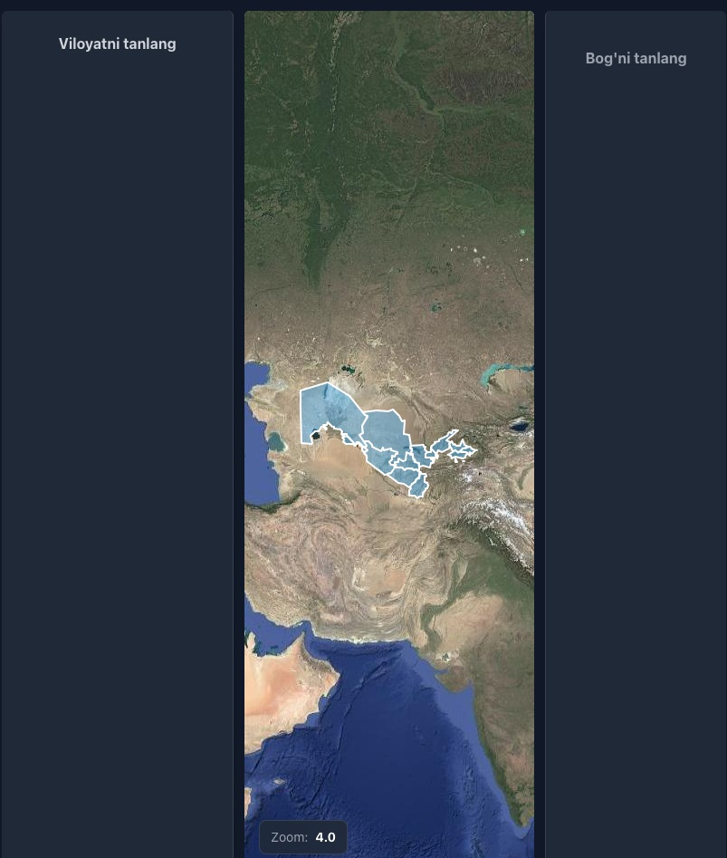
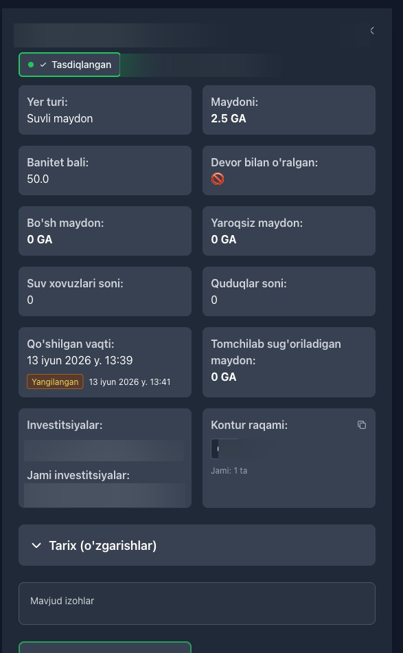
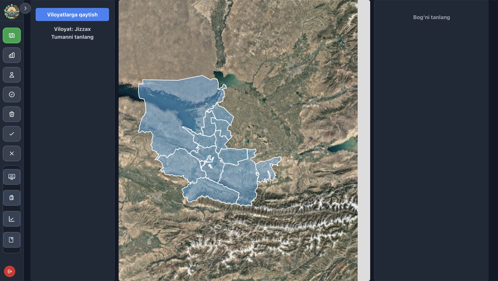

# GeoAgro

GeoAgro is Uzbekistan's national orchard inventory. I joined as a backend engineer and later led the engineering work at the Agro-Industry Development Agency. I worked on the Django API, data model, permissions and reporting, and coordinated integration with the web and mobile teams. My work on the project ran from October 2024 to March 2026.

District staff used to send much of this information in spreadsheets. A list of coordinates could tell the ministry that a garden existed, but it was hard to see its boundary, compare it with the surrounding area or find out who had changed a record.

[Maps and field work](#maps-and-field-work) · [System design](#system-design) · [Verification](./verification.md)

## Scale

The restored snapshot has **44,165 plantation records** and **38,378 farmer and organisation records**. It also contains roughly 628,000 polygon points and 498,000 history entries. These are database counts. The dashboard filters the data, so the totals on screen differ. The reported rollout covered 12 regions plus Karakalpakstan, with roughly 400 staff users over the life of the project.

## Maps and field work

District staff use the Flutter app to record an orchard's location and boundary. They enter crops, varieties and planted area, then attach photos and submit the record. The API applies district and region scope. Some field accounts also have location checks on the actions they can take.

On the web, staff can pick a region, open a district on satellite imagery and select a plantation. One boundary can contain several crops or varieties; the database stores their areas separately so they can be reported independently. The record can also track irrigation, land condition, subsidies and investments.

Regional map: Jizzakh

## Who approves a change

A new record goes from the district employee to the regional head, then to the republic administrator for the final decision. Editing an approved record starts the same review again. The backend saves the previous version before review and restores it if the edit is rejected. A deletion request goes through review and archives the record if approved. Staff can see comments and the history of changes when they review a record.

Reports use approved data. Staff can group by region, district or fruit, filter by year and export to Excel. When the report counts farmers, it deduplicates their identifiers rather than counting each of their plots.

Fruit and district breakdowns

## System design

[Editable diagram](./system-architecture.excalidraw)

The React web app and Flutter client use the same Django REST API. PostgreSQL stores the inventory and its history. A contour is a list of ordered latitude and longitude points; Python handles the geometry and Leaflet draws it on the map. This version did not need PostGIS. Redis and Celery run on the production VPS, according to the project owner. The mobile app uses Firebase Cloud Messaging and Telegram carries additional reports.

[Editable diagram](./moderation-workflow.excalidraw)

[Editable diagram](./data-model.excalidraw)

The web demo used a historical copy of the database. The published map and moderation screens obscure record names. See [verification notes](./verification.md) for the source review, local run and limits of the evidence.

[All case studies](../)
