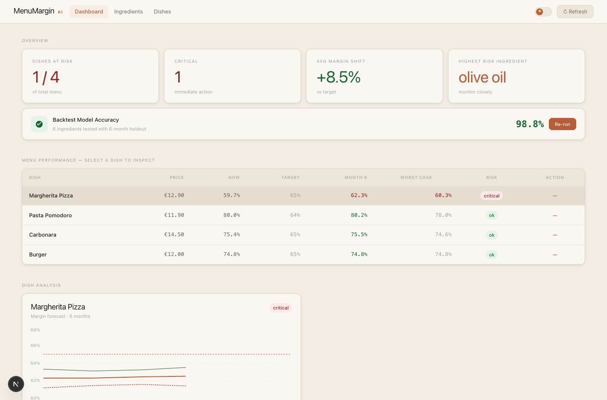
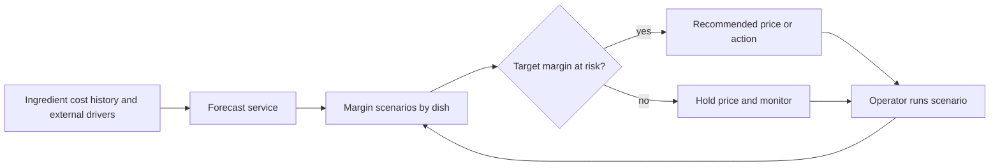
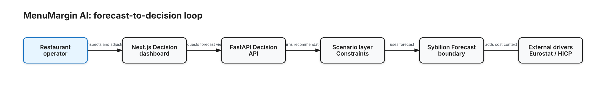
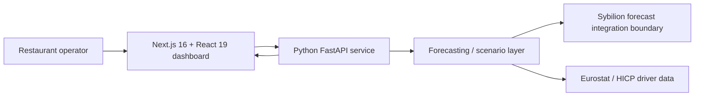
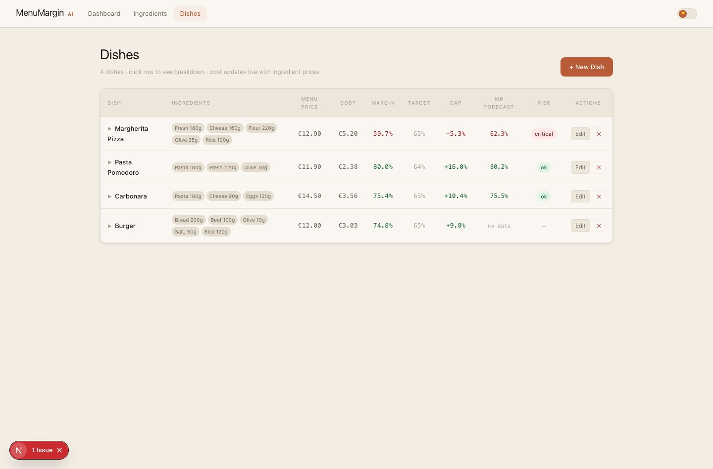
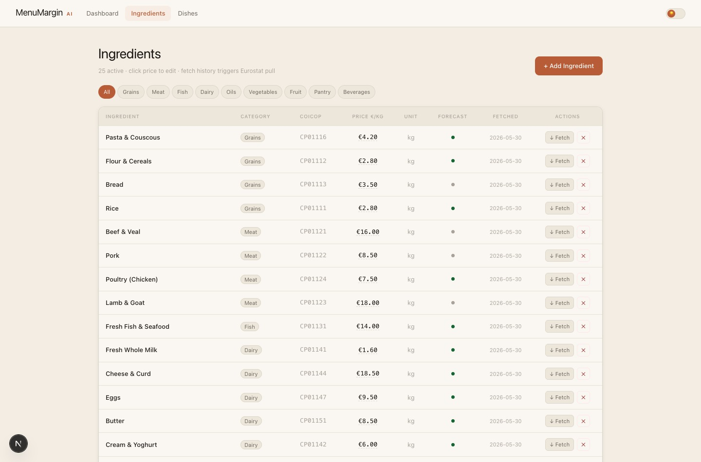

# MenuMargin AI

MenuMargin AI is a Zero One Hack_01 prototype for restaurant operators. It uses ingredient price forecasts to estimate a dish's margin over six months. An operator can compare the current menu price with an alternative before deciding whether to change it.

## From ingredient prices to a dish margin

The cost engine combines ingredient forecasts with the quantities in each recipe. It compares the estimated cost with the menu price and the operator's target margin. The dashboard shows which dishes are at risk and which ingredients drive the change. A scenario can limit a price increase or change assumptions such as supplier lead time and demand.

## System design

[Editable diagram](./system-design.excalidraw)

The Next.js interface calls a FastAPI service. The backend uses pandas and NumPy to work with the ingredient series and recipe quantities. The source includes a Eurostat connector and a Sybilion adapter. When the external forecast API is unavailable, the demo can use packaged forecasts.

## Forecast demo

The local API serves a four-dish sample menu. The demo analysis and scenario endpoints both returned results using cached forecasts. The backtest view demonstrates the comparison with a holdout period; the demo fallback can estimate accuracy from forecast bands. The sample results do not establish how accurately the prototype predicts a restaurant's costs.

[All case studies](../)
