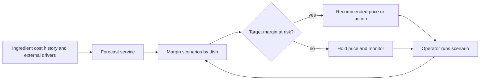
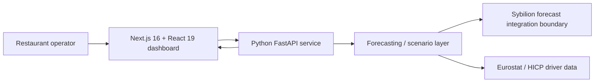
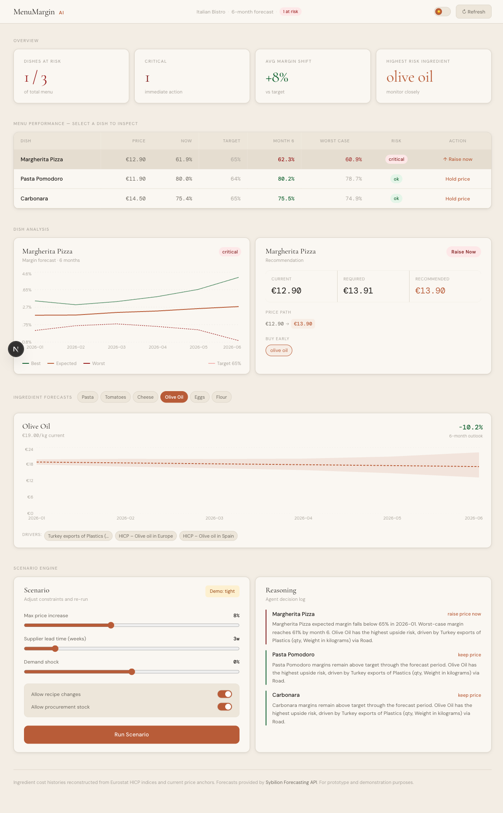
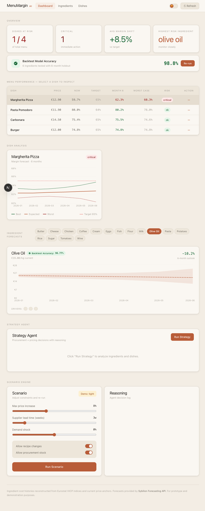

# MenuMargin AI

> A decision workspace that turns uncertain ingredient costs into concrete menu-price actions before margins are at risk.

MenuMargin AI was built during Zero One Hack_01 in the Sybilion forecasting track. It presents a restaurant operator with a six-month margin view, high-risk ingredients, scenario controls and actionable pricing recommendations.

## Decision flow

## System design

### What the interface makes visible

- dish-level current, expected and worst-case margin;
- a target-margin threshold and risk classification;
- ingredient-level forecasts and external drivers;
- recommended price changes;
- operator-controlled scenario constraints such as maximum increase, supplier lead time and demand shock;
- a readable decision/reasoning log.

## Visual evidence

| Screen | What it demonstrates |
| --- | --- |
|  | Dishes at risk, margin trajectories, price recommendation and scenario engine in one operational view |
|  | Forecast/backtest-oriented evidence from the local project materials |

## Technical evidence observed locally

- Next.js 16.2 / React 19 / TypeScript / Recharts frontend.
- FastAPI / Pydantic / pandas / NumPy / HTTP client backend.
- Repository includes an `eurostat_connector.py` and the project dependencies include a Sybilion integration boundary.

## Prototype boundary

This is a hackathon prototype. Demo datasets, forecasts and recommendations must be presented as demonstration material unless a subsequent code audit proves a production data pipeline and validation method. The final contribution statement will be added after factual review with Shamshodbek.
