# OfferFly

### Evidence-first AI voice interviews for faster, more consistent B2B recruiting

**Founder & CTO · Offerfly OG · Vienna · 2 B2B pilot clients**

OfferFly runs structured first-round interviews by voice, then gives recruiters a reviewable report: competency scores, question-level answers, transcript evidence, integrity signals and a clear recommendation. The product reduces repetitive screening work while keeping the final hiring decision with a human.

I founded OfferFly and lead product and engineering end to end: customer discovery, interview methodology, architecture, full-stack development, real-time voice infrastructure, AI orchestration, security boundaries, deployment and pilot delivery.

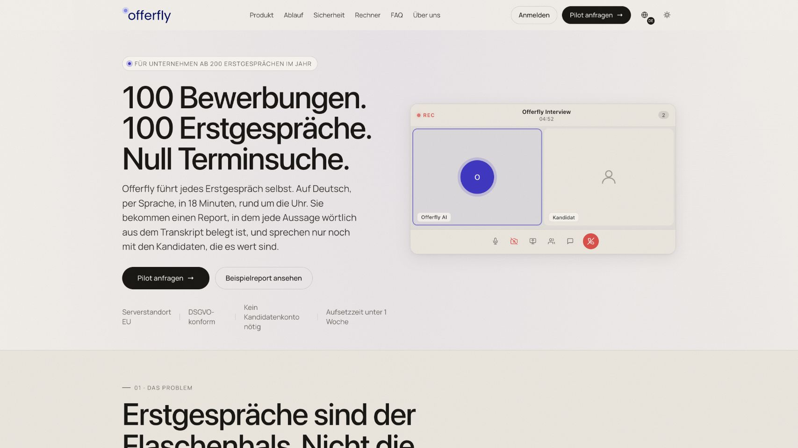

[Product](#product-walkthrough) · [System design](#system-design) · [Interview engine](#2-real-time-interview-engine) · [Data model](#3-domain-and-data-model) · [Trust model](#4-trusted-recruiting-lifecycle) · [Engineering](#engineering-challenges) · [Verification](./verification.md)

## Current product snapshot

| Signal | Verified scope |
| --- | ---: |
| B2B pilot clients | **2** |
| Product surfaces | **5** |
| Next.js pages | **36** |
| API route handlers | **94** |
| Prisma models | **30** |
| Automated checks passing | **199** |
| Editable architecture diagrams | **4** |

The pilot count is the founder-reported current commercial status. Repository and test counts were measured directly from the inspected local code. Screenshots below use a synthetic organization with 8 roles, 46 candidates and 34 completed interviews; those demo values are product evidence, not customer traction metrics.

## The problem

First-round recruiting interviews consume experienced employees' time, yet their quality varies by interviewer, schedule and note-taking discipline. A CV explains what a candidate claims to have done, but it rarely shows how clearly the person can explain a decision, handle a realistic situation or satisfy the exact requirements of one role.

Simple AI summaries do not solve the trust problem. A polished paragraph can hide missed questions, unsupported conclusions and inconsistent scoring. Recruiters need a repeatable conversation and a result they can inspect: what was asked, what was answered, where each conclusion came from and which parts still need human judgment.

OfferFly turns that process into one controlled workflow:

1. A recruiter creates a role, weights competencies and defines required or knockout questions.
2. Candidates enter through import, form or signed inbound-email intake.
3. OfferFly prepares a role blueprint, rubric and CV-specific probes.
4. The candidate receives a single-use magic link, gives explicit consent and joins without creating an account.
5. A real-time voice agent conducts the interview while deterministic code tracks required coverage and time.
6. The server validates evidence, computes the weighted score and builds a recruiter report.
7. A human reviews the interview and makes the final hiring decision.

## My role

As **Founder & CTO**, I own both the product direction and the technical system behind it. I translated customer discovery into the recruiter workflow, designed the B2B tenant and permission model, built the core Next.js application and API, separated the enterprise dashboard, implemented the Python voice worker, selected and integrated the AI providers, and deployed the pilot infrastructure.

The most important architectural choice was to constrain the probabilistic part of the system. The model can listen, reason and conduct a natural conversation. It cannot silently decide that required coverage is complete, invent transcript evidence or set the final score. Those responsibilities belong to deterministic services and remain visible to the recruiter.

## Product walkthrough

### A focused B2B proposition

The public product story is built around a concrete promise: structured interviews at any time, with a recruiter receiving evidence instead of another opaque AI summary. The landing experience explains the workflow, security model, report and expected operational value before asking a team to start a pilot.

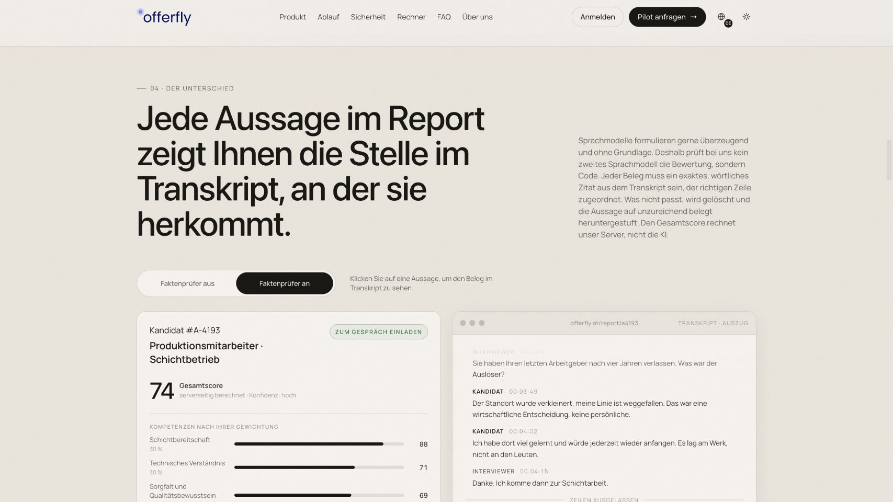

### Recruiter overview

The enterprise dashboard summarizes open roles, candidate volume, completed interviews, average score, score distribution and recent activity. Recruiters can move directly from a portfolio-level view into a role or candidate without switching systems.

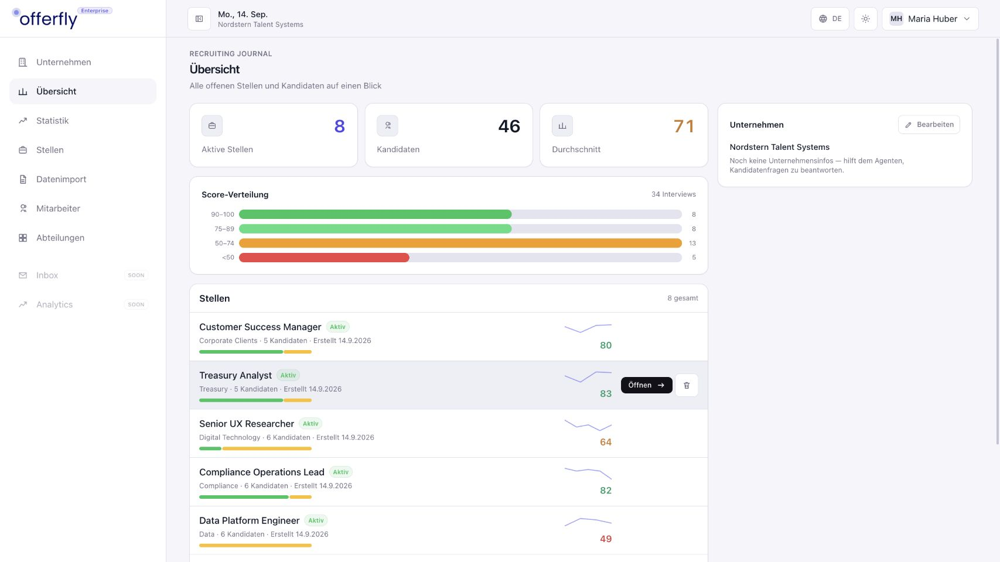

### Role-based candidate pipeline

Every candidate belongs to a job role and moves through an explicit status. Recruiters can filter and compare candidates, resend or revoke invitations, inspect completion state and open a report. Department access limits which roles an organization member can see.

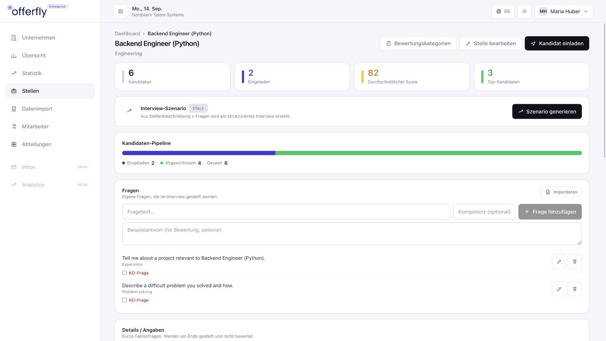

### Low-friction candidate admission

Candidates receive a time-limited, single-use invitation. The admission page identifies the role and organization, explains the voice interview, captures explicit AI and recording consent, checks the device, and then admits the candidate to the LiveKit room. No candidate password or permanent account is required.

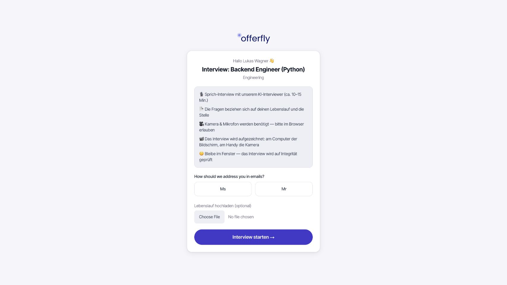

### A report built for review

The report combines a total score with competency-level results, interview answers, integrity signals and an explicit hiring recommendation. Evidence references must match exact transcript text; unsupported statements are removed or downgraded before the result is shown.

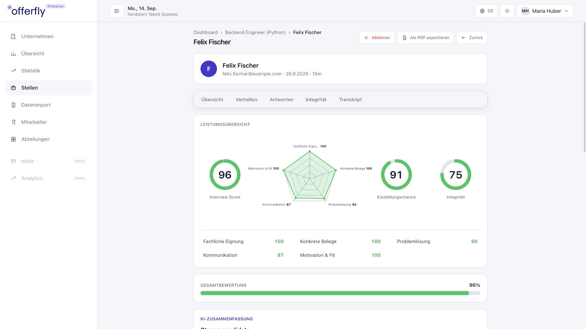

The report remains an aid to a recruiter. It does not automatically hire or reject a person. A reviewer can read the answer, inspect the cited transcript, listen to available recordings and record the final decision.

### Portfolio analytics and controlled intake

The statistics view helps a recruiting team understand volume, status distribution, scores and activity across roles. Candidate intake supports manual entry and spreadsheet import, while separate integrations cover Google Forms and signed inbound application email.

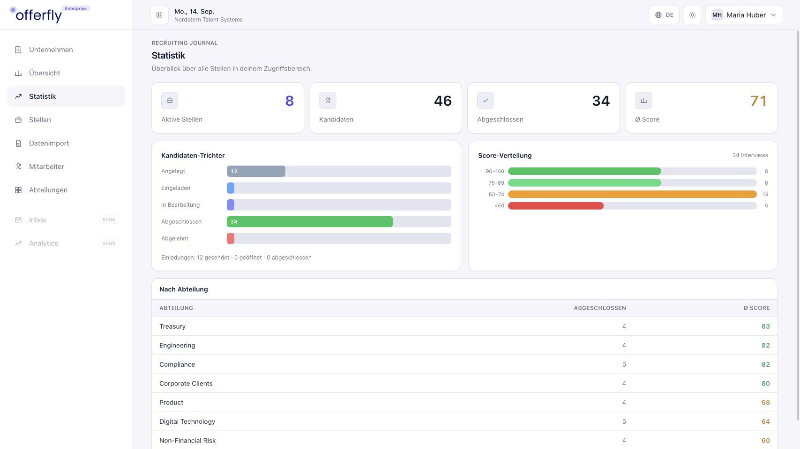

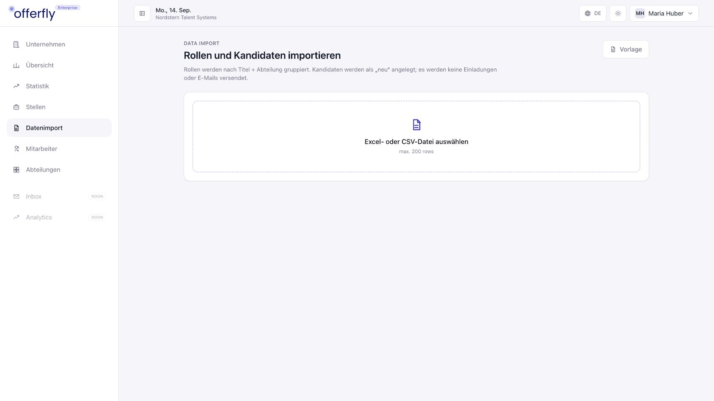

## Product principles

**Evidence before fluency.** A confident AI-generated explanation is insufficient. Every material claim in a candidate report must trace to an exact transcript passage.

**Conversation by AI, control by code.** The model adapts follow-ups and phrasing. The application owns the question plan, required-coverage state, completion gate, retry behavior and score calculation.

**Freeze the interview contract.** A role can evolve after candidates have been invited. Each session therefore stores immutable snapshots of the prompt, blueprint, rubric, probes and interview plan, plus their versions.

**One core, two modes.** B2B recruiter interviews and B2C interview practice share the session and voice foundation. A mode discriminator and separate domain rules keep the products from duplicating the hardest runtime logic.

**Human decision.** OfferFly prioritizes evidence and comparability. The recruiter remains responsible for the final decision and can challenge the recommendation.

**Pilot-scale operations with clear seams.** The current deployment uses a compact modular architecture on one VPS. Provider clients, the voice worker, domain modules and persisted snapshots establish boundaries that can be separated when measured load requires it.

## Main features

| Area | Implemented behavior |
| --- | --- |
| Tenant administration | Organizations, members, departments, role visibility and permission arrays |
| Role configuration | Job description, competency weights, organization context, custom, required and knockout questions |
| AI preparation | Versioned role blueprint, rubric, interview plan and CV-specific probes |
| Candidate intake | Manual entry, Excel/CSV import, Google Forms intake and inbound-email routing |
| Invitation | Single-use magic link, hashed token, expiry, consent timestamps and revocation state |
| Voice interview | Browser WebRTC, live transcription, adaptive follow-ups, VAD and multilingual turn detection |
| Coverage control | Question-attempt state, required-question completion gate and hard time boundary |
| Recording | Browser-side chunking with close-safe persistence and session-linked metadata |
| Evaluation | Batch transcript, exact-quote evidence validation and server-side weighted scoring |
| Recruiter report | Competencies, answers, evidence, confidence, integrity signals, recommendation and playback |
| Pipeline | Role-scoped candidate states, invitations, completion tracking, review and final decision |
| Analytics | Score distribution, role and candidate totals, status funnels and recent activity |
| B2C path | Cases, question packs, checkout, entitlements and usage tracking on the shared core |
| Operations | Pilot administration, health interfaces, Telegram alerts and Docker-based deployment |

## System design

The architecture is documented through four connected views. Each source is an editable Excalidraw file. Violet identifies AI and governed configuration, cyan marks transport and data movement, green marks controlled progress, amber marks evaluation or integrations, blue marks application boundaries, and red marks locks or failure-sensitive decisions.

### 1. Platform landscape

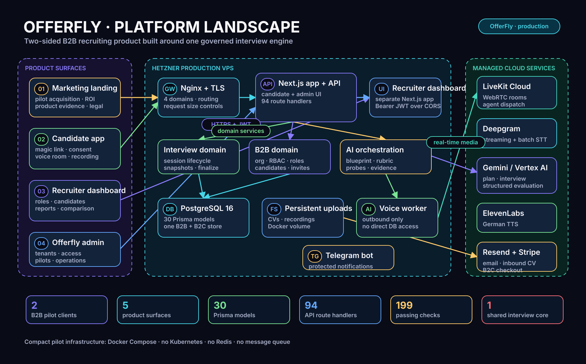

[Open the editable Excalidraw scene](./platform-landscape.excalidraw)

Five user-facing surfaces sit around one core platform: the marketing site, candidate app, enterprise recruiter dashboard, internal administration and Telegram operations bot. The central Next.js application exposes the candidate experience, administrative UI and 94 route handlers. The enterprise dashboard remains a separate deployable frontend and calls the B2B API with a bearer token over an explicit CORS boundary.

The production footprint is intentionally compact. Nginx terminates TLS and routes four domains to Docker services on a Hetzner VPS. PostgreSQL 16 stores the 30-model relational domain; persistent volumes hold uploaded CVs and recordings. A separate Python worker joins LiveKit rooms but has no direct database access: it communicates with narrow internal APIs and provider services.

LiveKit Cloud provides WebRTC transport and agent dispatch. Deepgram handles live and final transcription, Gemini through Vertex AI conducts and evaluates structured work, and ElevenLabs produces the German interview voice. Resend handles transactional and inbound email; Stripe supports the B2C path. This is a modular monolith plus a specialized real-time worker, rather than a collection of decorative microservices.

### 2. Real-time interview engine

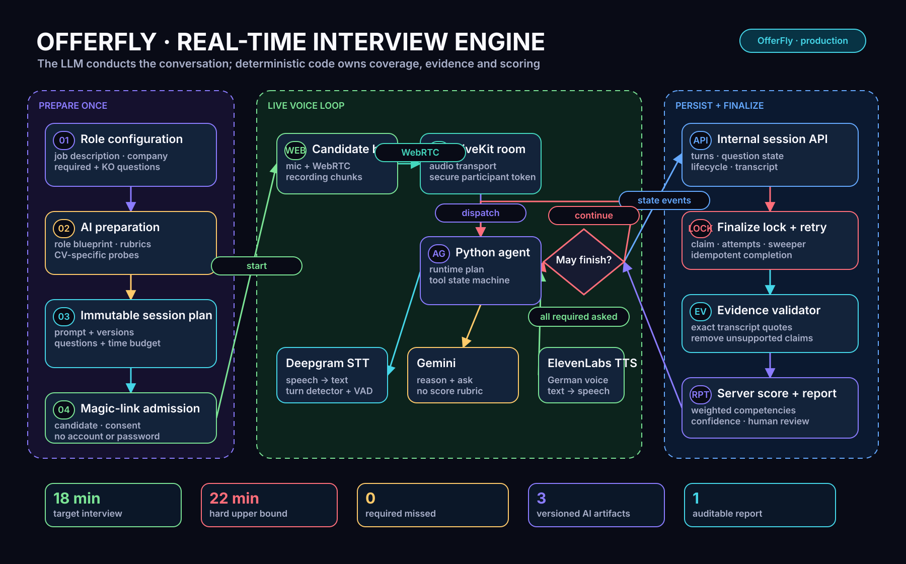

[Open the editable Excalidraw scene](./interview-runtime.excalidraw)

The runtime begins before the call. Role configuration, organization context, rubrics and CV probes become a versioned interview plan. When a candidate session is created, the system copies that plan and its versions into immutable session snapshots. A later role edit cannot change what an earlier candidate was supposed to be asked.

In the live loop, the browser sends audio through LiveKit. The Python 3.11 worker combines Silero voice activity detection and a multilingual turn detector with Deepgram streaming speech-to-text, Gemini reasoning and ElevenLabs text-to-speech. The model receives runtime tools and state, but it does not own the lifecycle.

The completion gate is deterministic. Question attempts record which required items were asked and answered. If required coverage is incomplete, the agent continues even when the model would otherwise conclude the interview. A hard upper time boundary prevents an uncontrolled conversation. Session events and transcript messages are persisted through the internal API.

Finalization uses an explicit lock, bounded retries and idempotent completion. Deepgram produces a final batch transcript; the evaluator proposes structured findings; an evidence validator checks every quote against the transcript; the server applies competency weights and computes the total. This split makes retries possible without creating duplicate reports or allowing a model response to become an unexamined hiring score.

### 3. Domain and data model

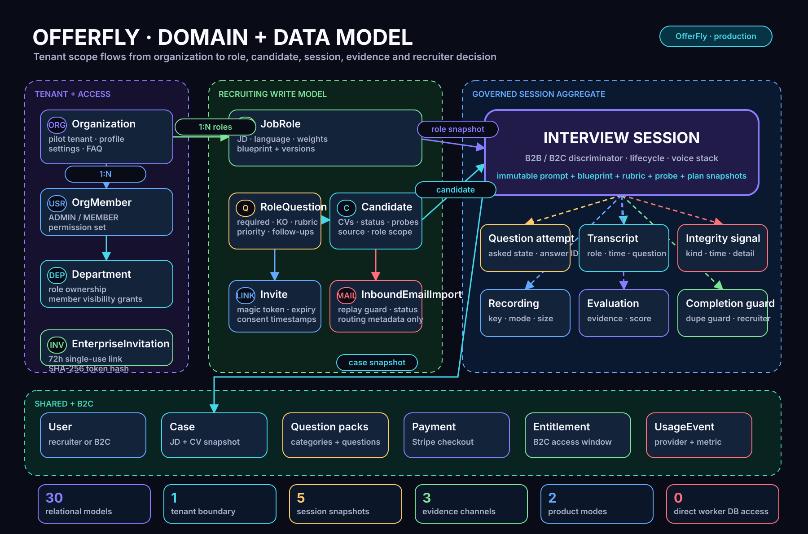

[Open the editable Excalidraw scene](./domain-data-model.excalidraw)

The B2B tenant boundary starts with `Organization`. `OrgMember` represents an authenticated recruiter or administrator, while department grants scope role visibility. `JobRole` contains recruiting configuration and versioned AI artifacts. Candidates, questions, invitations and inbound imports all remain attached to that organization and role context.

`InterviewSession` is the governed aggregate connecting both B2B and B2C modes to the live runtime. It stores lifecycle state and frozen prompt, blueprint, rubric, probe and plan snapshots. Question attempts, transcript messages, recordings, cheat signals, feedback results and completion notices provide an appendable evidence trail around the session.

The B2C product reuses the same interview foundation through users, cases, question packs, payments, entitlements and usage events. Sharing the session core reduces duplicated provider and voice logic while the tenant-specific B2B models preserve enterprise access and reporting semantics.

The Python worker deliberately has zero direct database access. This keeps provider credentials and a long-lived media process away from tenant queries and schema coupling. Database writes pass through application services that enforce session ownership and lifecycle rules.

### 4. Trusted recruiting lifecycle

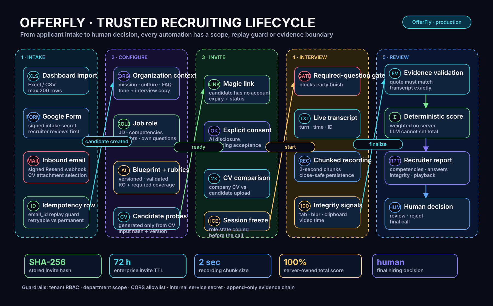

[Open the editable Excalidraw scene](./trusted-lifecycle.excalidraw)

Trust begins at intake. Spreadsheet imports are bounded and validated. Google Forms requests use a shared intake secret. Resend webhook signatures are verified, candidate attachments are selected deliberately, and `resendEmailId` provides a replay guard. The database stores routing metadata rather than retaining an unnecessary copy of the complete inbound message and every attachment.

Configuration is versioned before invitation. Magic-link tokens are stored as SHA-256 hashes, expire after 72 hours and can be consumed only once. Candidate consent and AI disclosure are recorded explicitly. A session freeze preserves the role state used for the call.

During the interview, transcript turns carry identities and timestamps, recordings arrive in small chunks, and integrity events capture signals such as tab blur, clipboard activity and abnormal video time. These signals inform review; they are not treated as automatic proof of misconduct.

At finalization, exact-quote validation removes unsupported evidence, deterministic weighting produces the total score, and the recruiter receives the report. Tenant RBAC, department scope, an origin allowlist and an internal-service secret protect the boundaries around that flow. The last action is always a human review, rejection or hiring decision.

## Technical stack

| Layer | Technologies verified in the inspected repositories |
| --- | --- |
| Candidate and core app | Next.js 15, React 19, TypeScript, Tailwind CSS, Next route handlers |
| Enterprise dashboard | Separate Next.js 15 / React 19 application, bearer JWT client, SheetJS import |
| Data | PostgreSQL 16, Prisma 5, 30 relational models, persisted JSON snapshots where immutability matters |
| Voice worker | Python 3.11, LiveKit Agents, HTTPX, provider plugins |
| Real-time media | LiveKit Cloud, WebRTC, Silero VAD, multilingual turn detector |
| Speech and AI | Deepgram streaming/batch STT, Gemini via Vertex AI, ElevenLabs TTS |
| Product integrations | Resend, signed inbound webhooks, Google Forms intake, Stripe, Telegram |
| Delivery | Hetzner VPS, Docker Compose, Nginx, Let's Encrypt, persistent database/upload volumes |
| Quality | Vitest, Python unittest, TypeScript checks and production Next.js builds |

## Engineering challenges

### Natural turn-taking without losing control

A useful voice interview cannot feel like a sequence of audio forms. It needs interruption handling, silence detection, follow-up questions and quick responses. At the same time, the agent must not drift away from the required plan. OfferFly separates conversational behavior from interview state: provider plugins handle speech, the model handles phrasing and reasoning, and runtime tools expose the next allowed action.

### Required coverage under a fixed time budget

A model may decide that a conversation feels complete even when a mandatory question was skipped. The system stores attempts and answer state per planned question and checks them before completion. The agent receives a continuation path until all required items are covered or the hard upper bound is reached. This makes completion a reproducible product rule.

### Comparable interviews after role changes

Recruiters refine prompts, weights and questions during a pilot. Reading the current role configuration during finalization would make an old session impossible to reproduce. OfferFly snapshots the exact prompt and versioned artifacts at session creation, allowing the report to be interpreted against the contract used during the call.

### Grounding conclusions in the transcript

Structured output alone does not guarantee truthful evidence. The evaluator can propose claims and quotes, but a second service confirms that each cited passage exists in the final transcript and belongs to the expected context. Unsupported material is discarded or lowers confidence. Recruiters can then inspect the same source used by the system.

### Keeping the score outside the model

The LLM returns competency-level evidence and judgments under a rubric. Server code validates the shape, applies configured weights and calculates the total. This prevents the model from bypassing a recruiter's priorities with a persuasive but mathematically inconsistent overall number.

### Multi-tenant access inside one pilot platform

Organizations need shared administration without giving every member access to every role. The domain combines organization membership, permissions and department grants, and API queries enforce the same scope used by the dashboard. The separate dashboard crosses a deliberate authenticated CORS boundary rather than receiving direct database access.

### Reliable intake from external systems

Email providers retry webhooks, attachments may be ambiguous, and a temporary provider error should not create a duplicate candidate. Signature verification establishes origin, `resendEmailId` prevents replay, and the import record distinguishes retryable from permanent outcomes. Similar narrow boundaries protect Google Forms and internal bot calls.

### Finalization across several AI providers

Live sessions can disconnect, provider callbacks can repeat and a final transcript may arrive after the browser closes. A claimable finalization lock, attempt counters, completion guards and a sweeper turn this into an idempotent state transition. The report appears once even when the underlying process retries.

### Shipping the right infrastructure for pilots

The system currently runs without Kubernetes, Redis, a message queue, S3 or a separate staging cluster. That is a conscious pilot-stage tradeoff: fewer moving parts, faster debugging and lower operating cost. The architecture keeps provider, worker, storage and application boundaries clear so that object storage, queued work or service separation can be introduced from measured pressure rather than prediction.

## Review and lessons

OfferFly's strongest technical property is the chain from a role requirement to a reviewable piece of evidence. The voice interface is the visible innovation, but the durable product value comes from session snapshots, required-question state, transcript grounding, deterministic scoring and human review working together.

Building the product taught me that AI reliability often comes from the surrounding software rather than a longer prompt. Versioning, validators, locks, replay guards and explicit state transitions make model behavior usable inside a business workflow. They also create better pilot conversations because a recruiter can challenge a result and see how it was produced.

The next infrastructure investments should follow pilot usage. I would add central error and latency monitoring, a repeatable staging environment and restore-tested backups first. Object storage becomes valuable when recording volume or multi-host delivery justifies it. A durable queue becomes useful when finalization throughput or retry isolation exceeds what the current lock-and-sweeper design can handle. These are defined evolution points, not requirements for proving the product with two pilots.

## Verification and evidence

All five product surfaces and the supporting Telegram bot were inspected locally. The core app and enterprise dashboard completed production builds. Automated runs passed **176 app tests**, **13 dashboard tests** and **10 Python worker tests**, for **199 passing checks**.

The screenshots were captured from locally running builds against an isolated PostgreSQL database populated only with synthetic recruiting records. No real candidate, employee or pilot-client data is included. A paid live interview across external voice and AI providers was not started during this review; the worker pipeline, provider configuration, state transitions and tests were inspected directly.

The private implementation remains private. This case publishes product behavior, aggregate code measurements, editable architecture diagrams and non-sensitive visual evidence. See the [verification notes](./verification.md) for commands, scope and evidence limits.

[← All portfolio case studies](../README.md)
