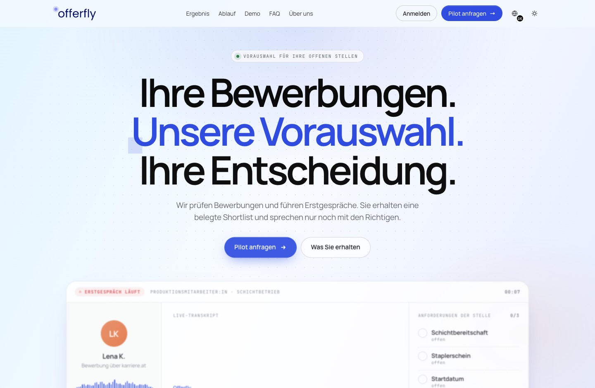

# OfferFly

I'm the founder and CTO of OfferFly, a voice interview platform with **2 B2B pilot clients** at the time of the case review. I worked on the recruiter and candidate apps, the interview runtime and deployment. The final hiring decision stays with the recruiter.

[Website](https://offerfly.at/) · [System design](#system-design) · [Verification](./verification.md)

## A recruiter sets up a role

The recruiter chooses the competencies, their weights and the questions every candidate should answer. Candidates enter through a form, spreadsheet import or an email intake integration. The email webhook verifies the provider signature and tracks the provider message ID so a retry does not import the candidate twice. Before the candidate joins, OfferFly prepares the interview plan and saves a copy of the configuration with that session. Changing the role later won't change the rubric for an interview that already took place.

## From invitation to report

Candidates open a single-use link that expires after 72 hours, give consent and join the call. The voice agent can follow up on an answer or recover from an interruption. The application keeps track of which required questions have been covered and how much time is left.

After the call, the evaluator proposes findings. The server checks each cited quote against the final transcript and computes the overall score from the rubric weights. A recruiter can open the report and check the passage behind a score.

Import and recruiting statistics

## System design

[Editable diagram](./platform-landscape.excalidraw)

The recruiter dashboard and candidate app are Next.js applications. The core API owns organisation membership, department access and session state in PostgreSQL through Prisma. The Python voice worker talks to the API and has no direct database connection. The documented deployment uses Docker Compose on a Hetzner VPS, with Nginx routing traffic and persistent volumes for uploads and the database.

[Editable diagram](./interview-runtime.excalidraw)

LiveKit carries the audio. Deepgram transcribes it, Gemini on Vertex AI handles the conversation and assessment, and ElevenLabs produces the voice. After the call, a finalization lock and retry rules let the backend finish a session if a callback repeats or the browser has closed.

[Editable diagram](./domain-data-model.excalidraw)

[Editable diagram](./trusted-lifecycle.excalidraw)

The landing screenshot comes from the local B2B site. The recruiter screenshots use a fictional organisation. They show how the product works; the counts on those screens are demo data. The [verification notes](./verification.md) record which apps were run and which provider calls were left out of the test.

[All case studies](../)
