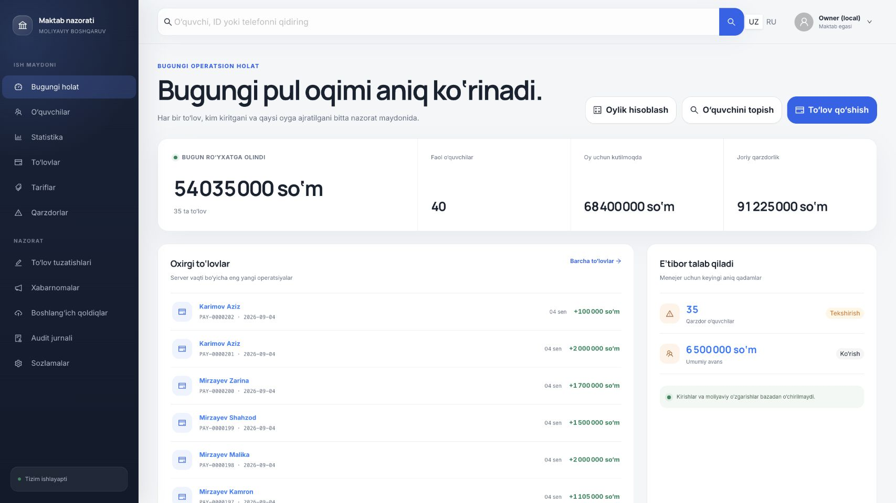
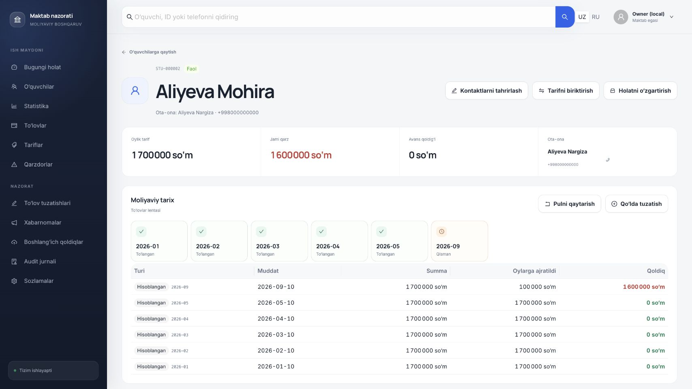
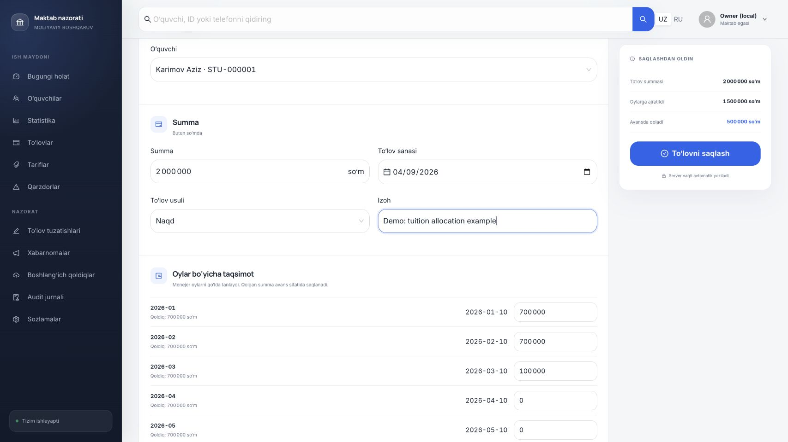
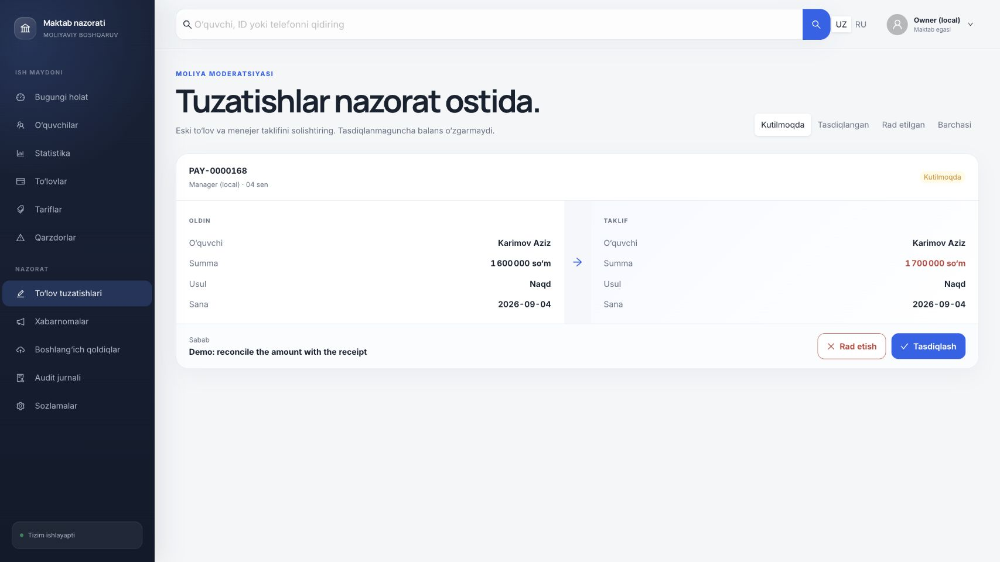
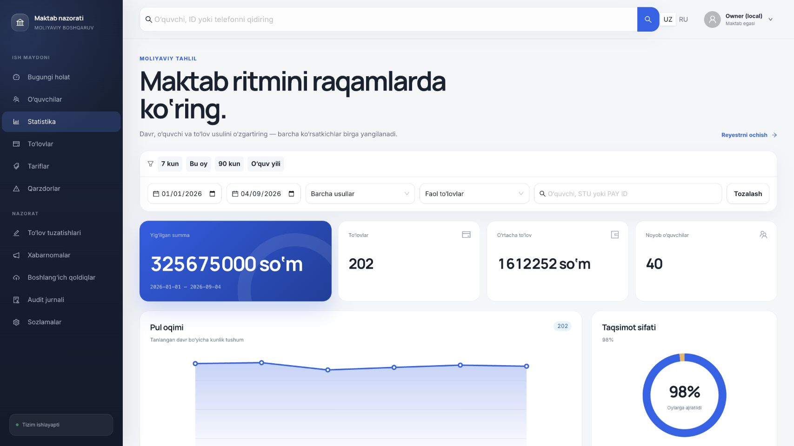
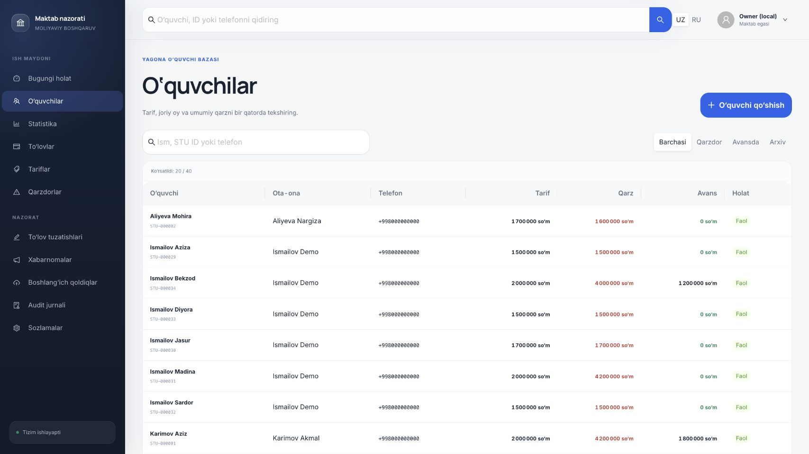
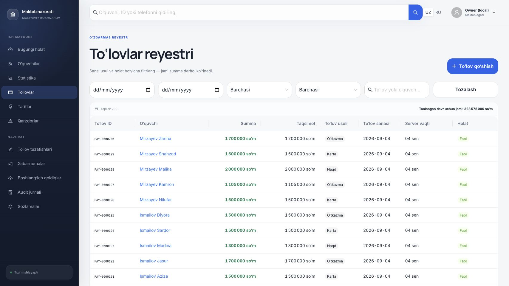
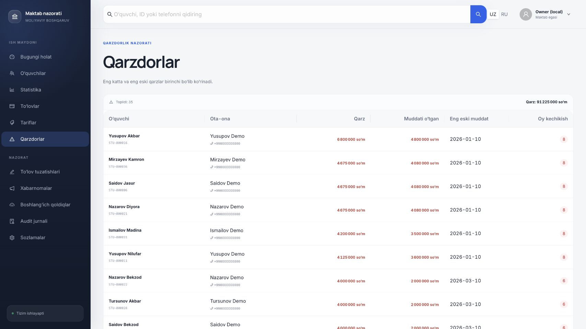
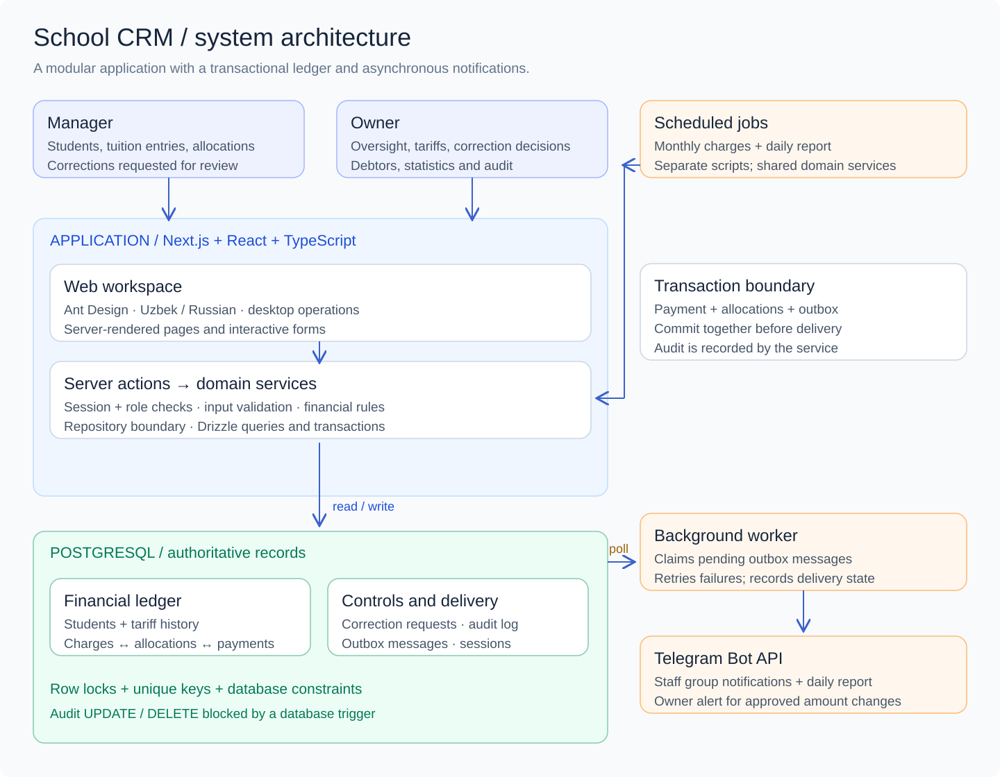
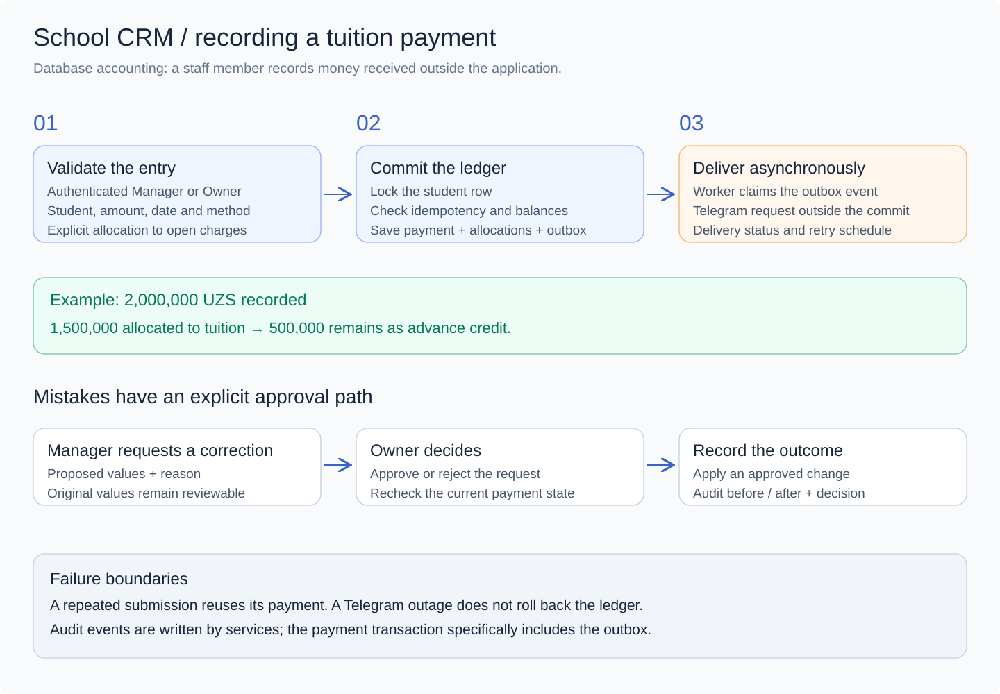

# School CRM

> Tuition accounting, student balances and owner oversight for a private school in Uzbekistan.

I designed and built this application independently, from the database and financial rules to the staff interface and Telegram notifications. It gives managers one workspace to record tuition, allocate it to specific months and track debt, while the owner reviews corrections and monitors the school's finances.

**Solo full-stack developer · June–September 2026 · In production · Private client**

| Production scope | Reported usage |
| --- | --- |
| Schools | **1** private school in Gulistan, Uzbekistan |
| Students | **150** |
| Staff access | **4 users**, including **2 managers** |
| Recorded transactions | **600+** accounting entries |
| Operational reporting | Financial statistics and Telegram notifications |

*Production figures and delivery period were confirmed by the developer in September 2026. They describe the live installation; screenshots below use a separate synthetic dataset.*

**“Payment” means a database record of money received outside the application. The CRM does not collect funds, charge cards or integrate with payment gateways.** Method labels such as cash, transfer, Click or Payme classify the staff-entered record.

[Product walkthrough](#product-walkthrough) · [System design](#system-design) · [Engineering challenges](#engineering-challenges) · [Review and lessons](#review-and-lessons) · [Verification](./verification.md)

## The problem

School tuition is more complicated than a list of paid and unpaid students. A family can pay part of a month, cover several months at once or leave an advance. Tariffs and discounts change over time. A manager can enter the wrong amount or attach a payment to the wrong student. The owner needs to understand both the current balance and how it was produced.

The system brings those questions into one operational record: **who owes what, which month a payment covers, who recorded it, and who approved a correction**. It combines student administration, tuition accounting and financial oversight for a small staff team.

## My role

I was the sole developer across frontend, backend and database design. My work covered the Uzbek/Russian interface, authentication and permissions, student and tariff management, the financial ledger, correction approvals, audit records, reporting, Telegram delivery and automated tests.

The project required translating school-specific operating rules into explicit application behaviour: when billing starts, how an advance is represented, which changes require approval and what information must remain available after a correction.

## Product walkthrough

### Student records with an explainable balance

The student directory combines contact information, current tuition, outstanding debt and advance credit. Search and balance filters help staff find the next account requiring attention. Each profile opens into a monthly ledger, tariff history and recorded operations.

### Record tuition and allocate it deliberately

A manager selects the student, enters the amount, date and method, and assigns money to outstanding charges. A summary shows the allocated amount and the remainder that becomes advance credit before saving. The payment register supports date, method, status and student filters with totals for the selected records.

### Correct mistakes through owner review

A correction request contains the original values, proposed values and a reason. The owner can approve or reject it. The request itself does not change the balance. Approval applies the correction and recalculates the affected allocations; the audit records retain the before/after context and decision.

### Turn accounting records into an operational view

The daily dashboard shows recorded tuition, active students, expected monthly charges and debt. Statistics add date filters, payment-method breakdowns, average recorded amount, unique students and allocation-versus-advance totals. These figures are derived from ledger records.

More screens: student directory, payment register and debtors

**Student directory** — balances beside contact details and tariffs.

**Payment register** — searchable accounting entries with allocation amounts and staff timestamps.

**Debtors** — outstanding accounts for staff follow-up.

## Main features

| Area | Implemented behaviour |
| --- | --- |
| Student administration | Searchable profiles, parent contacts, enrolment dates and student statuses |
| Tuition rules | Tariff catalogue, discounts and tariff history with effective dates |
| Monthly billing | Repeat-safe charge generation for the configured school calendar |
| Financial ledger | Partial allocations, advance balances, refunds and controlled adjustments |
| Correction workflow | Manager request, owner decision, original/proposed values and reasons |
| Reporting | Daily overview, debtors, filtered statistics and payment-method breakdowns |
| Initial migration | XLSX opening-balance import with validation, dry run and duplicate-file detection |
| Accountability | Server-side roles, actor attribution and database-protected audit records |
| Notifications | Telegram events, daily reports, delivery states and retry handling |
| Localization | Uzbek and Russian interfaces; UZS accounting and Asia/Tashkent business dates |

## System design

The application is a **modular monolith**. Next.js hosts the interface and server actions; domain services enforce business rules, while repositories handle PostgreSQL access. Scheduled scripts and the notification worker reuse the same service layer. This keeps the deployment and transaction model proportionate to a single-school installation.

[Editable architecture (.excalidraw)](./system-design.excalidraw) · [Editable payment workflow (.excalidraw)](./payment-workflow.excalidraw)

Download either file and open it in [Excalidraw](https://excalidraw.com). The diagrams describe the inspected application structure; they are not a claim about a particular production hosting provider or cluster topology.

### The financial model

**Charges** represent amounts owed; **payments** represent recorded credits. **Allocations** link a payment to specific charges. The part of a payment left unallocated is advance credit. Tariff history preserves the tuition amount applicable to a billing period.

For example, recording **2,000,000 UZS** and allocating **1,500,000 UZS** to a monthly charge leaves **500,000 UZS** available as advance. This is an illustrative accounting example, not a production transaction.

Amounts use integer UZS values backed by PostgreSQL `bigint`. Business dates use the school's timezone, while server recording timestamps remain separately available.

### Reliability at the write boundary

Payment creation locks the student row, rechecks allocations and uses a unique idempotency key. The **payment, allocations and outbox event commit together**. A repeated submission can return the existing payment instead of creating a second record. Monthly charges have a unique student/period constraint so rerunning a billing job does not duplicate tuition.

Telegram delivery happens afterward. The worker claims queued messages using `FOR UPDATE SKIP LOCKED`, records attempts and schedules retries. This separates a committed accounting entry from the availability of an external messaging service. It does not imply exactly-once external message delivery.

Audit events are recorded by the service layer. A PostgreSQL trigger blocks ordinary `UPDATE` and `DELETE` operations on the audit table. The specific atomic guarantee above covers the payment and its outbox event; the implementation does not put every audit write into that same transaction.

## Stack

| Layer | Technologies in the inspected source |
| --- | --- |
| Application | Next.js 16, React 19, TypeScript 6 |
| Interface | Ant Design 6, CSS Modules, local font assets |
| Authentication | Better Auth, Argon2id, Owner/Manager permissions |
| Persistence | PostgreSQL, Drizzle ORM, SQL migrations |
| Validation and imports | Zod, ExcelJS |
| Notifications | Telegram Bot API, PostgreSQL transactional outbox, standalone worker |
| Verification | Vitest, Testing Library, integration tests against PostgreSQL |

## Engineering challenges

**A balance must be explainable.** A single editable balance would hide which months were settled and why money remained available. Separate charges, payments and allocations make partial settlement, advances and historical tuition visible in both the model and interface.

**Retries and concurrent staff actions must not create money.** Disabling a submit button is insufficient once two requests reach the server. Unique keys, a student row lock and checks inside the transaction protect the payment write. Real PostgreSQL integration tests exercise the constraints and concurrency behaviour.

**Fixing an entry must preserve accountability.** Corrections are represented as requests with original values, proposed values and a decision. That gives the owner a reviewable change and gives staff a supported way to correct mistakes.

**Notifications must not control accounting availability.** An outbox makes the notification intent durable in the same commit as the payment. A separate worker handles delivery failures and retries without holding the financial transaction open.

**Dates and tariffs encode business policy.** Billing months, enrolment timing, discounts, effective dates and backdating rules need consistent interpretation. Keeping these rules in the domain layer avoids different answers across forms, monthly jobs and reports.

## Review and lessons

The strongest part of this project is the connection between everyday staff work and explicit financial rules. The directory, allocation form, approval screen and statistics expose the same underlying accounting model from different operational perspectives.

The engineering lessons I take from the implementation are to model the financial rules before shaping the dashboard, enforce correctness at the database boundary, make exceptional actions such as corrections first-class workflows, and test transaction behaviour against the database that actually runs the application.

The design also has clear tradeoffs. This is a focused single-school system, with desktop-oriented financial operations and mobile read-only behaviour. The audit trigger protects ordinary application writes, rather than providing cryptographic tamper evidence. Separately written audit events are a boundary worth tightening if stronger atomic audit guarantees become a requirement.

A useful next operational improvement would be measured outcomes: reconciliation time, correction frequency and overdue-balance trends. Those measurements are not available for this case, so no percentage savings or revenue impact are claimed.

## Verification and evidence

The application was started locally against an isolated PostgreSQL database and exercised through the browser. The screenshots show synthetic pupils and accounting records; no production database or real Telegram recipient was used for the demonstration.

- **279 unit/component tests passed** across 29 files.
- **34 PostgreSQL integration tests passed** across 2 files.
- **TypeScript validation passed.**
- Two small UI bugs were corrected: clipped profile text and stale allocation balances after saving a payment.

See [verification notes](./verification.md) for the checked routes, evidence boundaries and demo details. The client's identity and proprietary application source remain private.

[← All portfolio case studies](../README.md)
