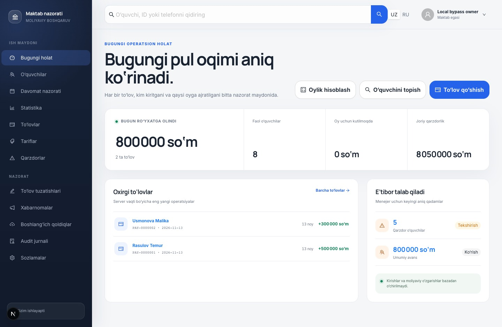
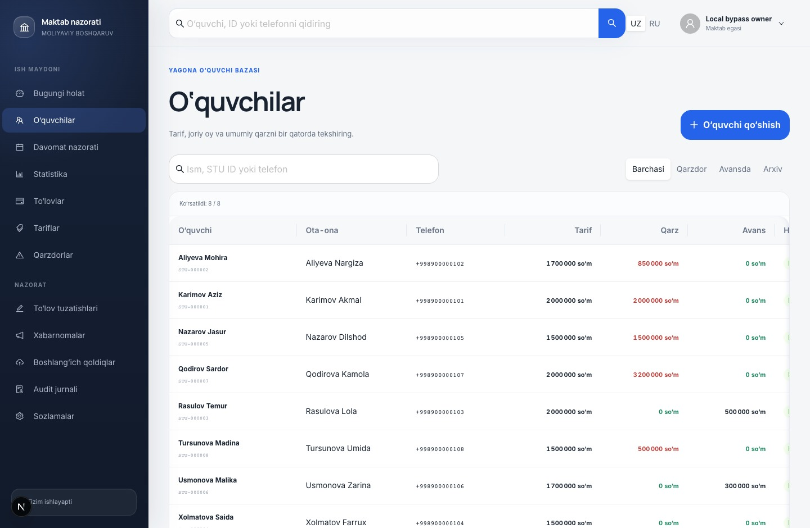
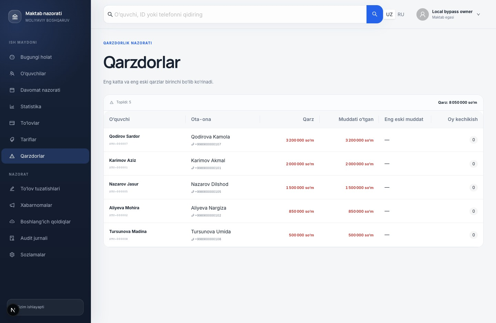

# School CRM

I built this CRM for a private school in Gulistan. Managers use it to record tuition and check which months are outstanding. The owner reviews corrections and sees the school's totals. The staff accounts include two managers. In September 2026, I reported **150 students**, **4 staff accounts** and **600+ accounting entries**.

A payment in the CRM is an entry for money the school has already received. The app does not charge cards or take online payments.

[System design](#system-design) · [Verification](./verification.md)

## Recording tuition

A student has a tariff and a monthly ledger. A manager can record 2,000,000 UZS, put 1,500,000 UZS against a charge and leave 500,000 UZS as credit. The ledger keeps the months, payments and allocations visible so the next manager can see how the balance was calculated.

## Correcting an entry

A manager submits a correction with a reason. The owner sees the recorded and proposed values side by side before accepting or rejecting it. The history records who acted. Staff can also look up overdue accounts and see the oldest outstanding date.

Student, payment and debtor lists

## System design

[Editable diagram](./system-design.excalidraw)

Next.js hosts the interface and server actions. The services check Owner and Manager permissions and use Drizzle to read and write PostgreSQL. Amounts are whole UZS stored as `bigint`. Tariffs have effective dates, and billing uses the school's Asia/Tashkent calendar. An XLSX import supports opening balances and has a dry run.

[Editable diagram](./payment-workflow.excalidraw)

When a manager saves a payment, the service locks the student's row and checks the allocations again. The payment, allocations and outbox event commit together. A unique request key protects against a duplicate submit. Telegram delivery happens afterward, and the worker records attempts and retries. The service records audit events separately; a database trigger blocks ordinary updates and deletes on the audit table.

The screenshots use synthetic pupils and payments. [Verification notes](./verification.md) describe the local PostgreSQL run and the checks on the payment form.

[All case studies](../)
