# Sofmetal ERP

Custom ERP for a metal distributor and processor in Uzbekistan. I worked on the Django backend, designed the deal approval flow and connected it to the React screens used by each department.

One order could include steel already in the warehouse, material a supplier still had to source, cutting and delivery. Before the ERP, the quotation, payment details and release documents could be in different spreadsheets, systems or chats. We gave everyone the same deal reference and a way to see who was waiting on whom.

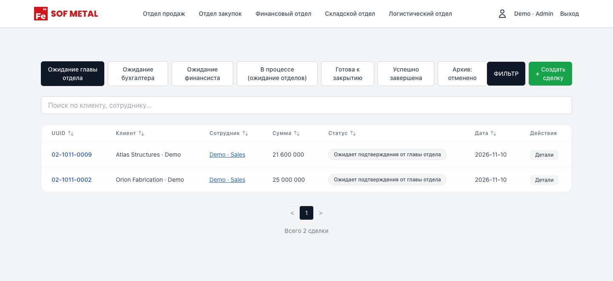

[Product walkthrough](#product-walkthrough) · [System design](#system-design) · [Verification](verification.md)

## Product walkthrough

### Sales

The deal register is organised by what needs to happen next. Opening a deal shows the customer, salesperson, terms and line items, along with the payment and delivery statuses. A line keeps the price agreed with the customer even if the catalogue price changes later.

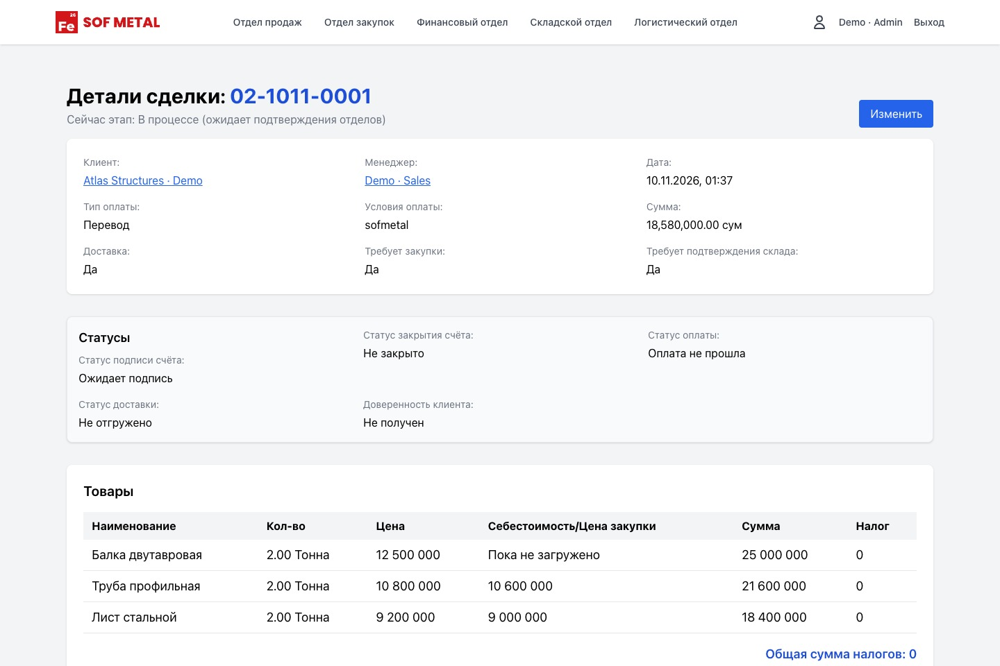

### Warehouse and procurement

Warehouse confirms the items already in stock. Procurement handles the items that still need a supplier. The catalogue distinguishes the two, and a single deal can contain both.

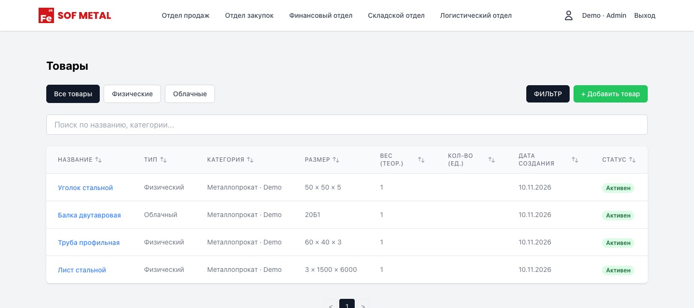

A purchase request has its own supplier, payment terms and lines. Each inventory batch records its purchase price and remaining quantity, so the ERP can keep track of stock bought at different prices.

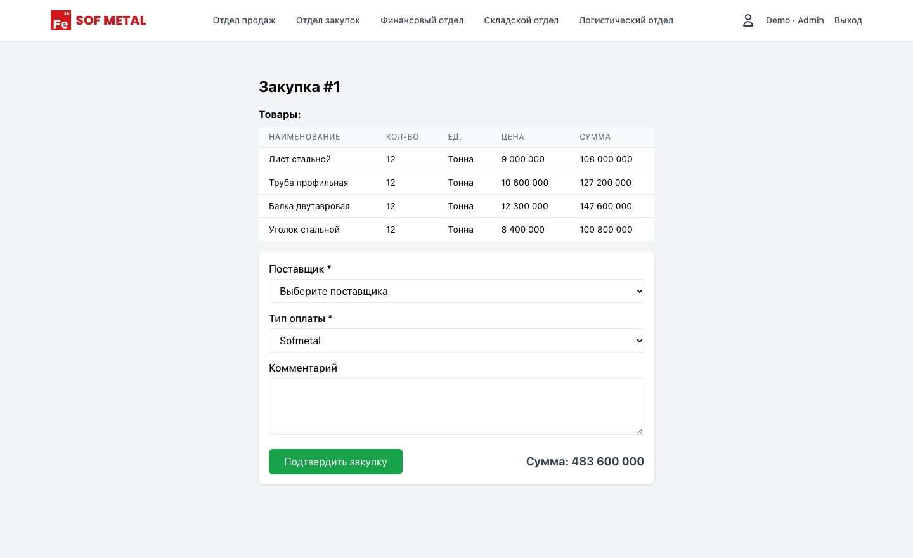

### Logistics

The delivery section shows the route, vehicles, cost and who pays. The logistics user confirms delivery arrangements from the deal screen. A packing charge goes under expenses, while a note about the shipment goes in the comment thread. Neither changes the agreed sale price.

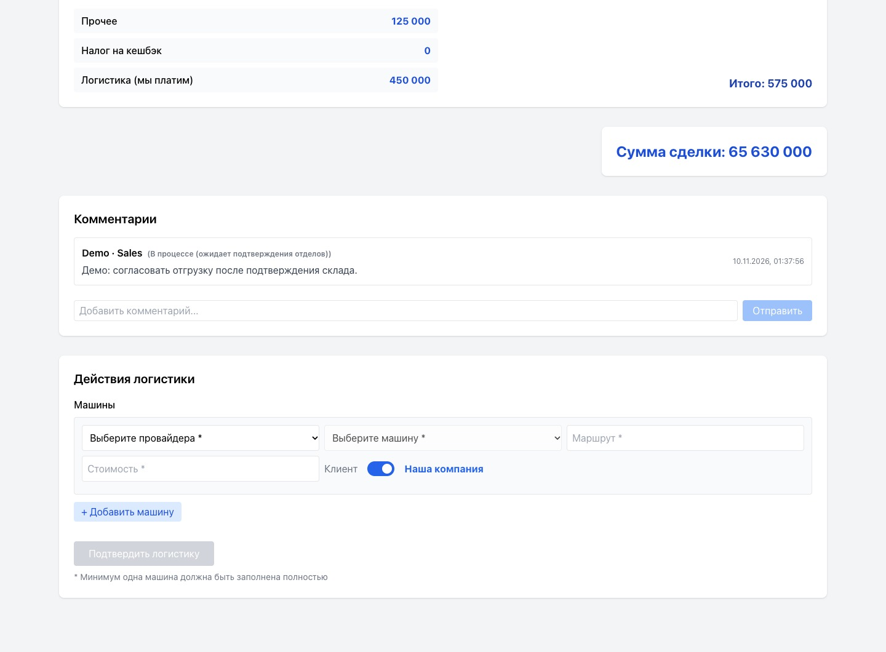

### Finance

Finance has separate queues for review, closing and archived deals. A finance user can see whether the invoice is signed, whether payment has arrived and whether the order has shipped. Those fields stay separate from the approval stage.

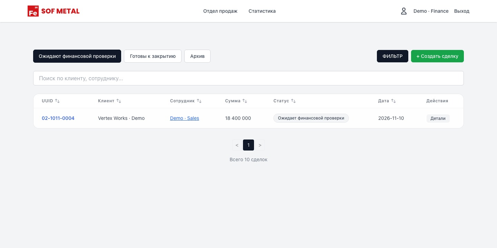

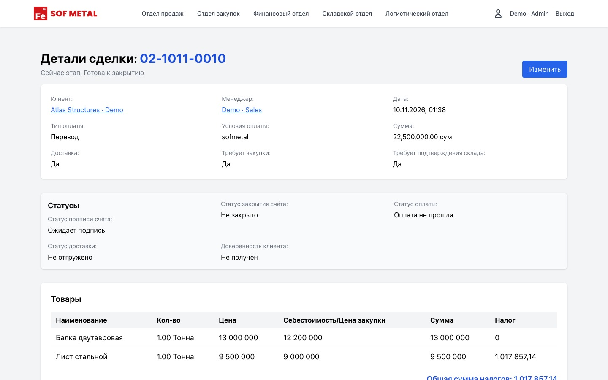

More product screens

ERP navigation

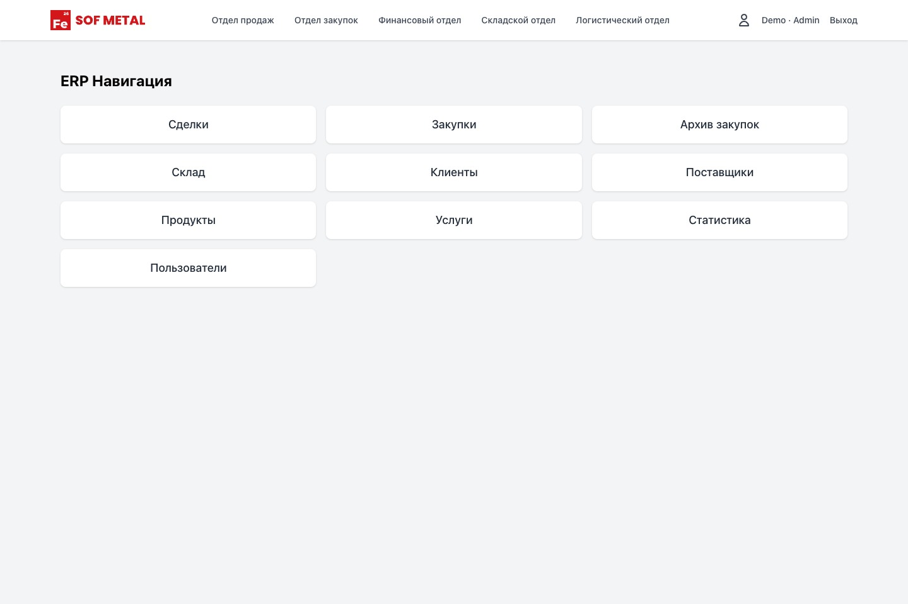

Procurement register

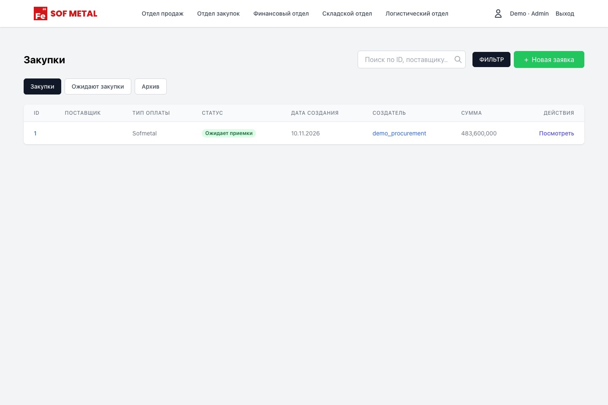

Customer directory

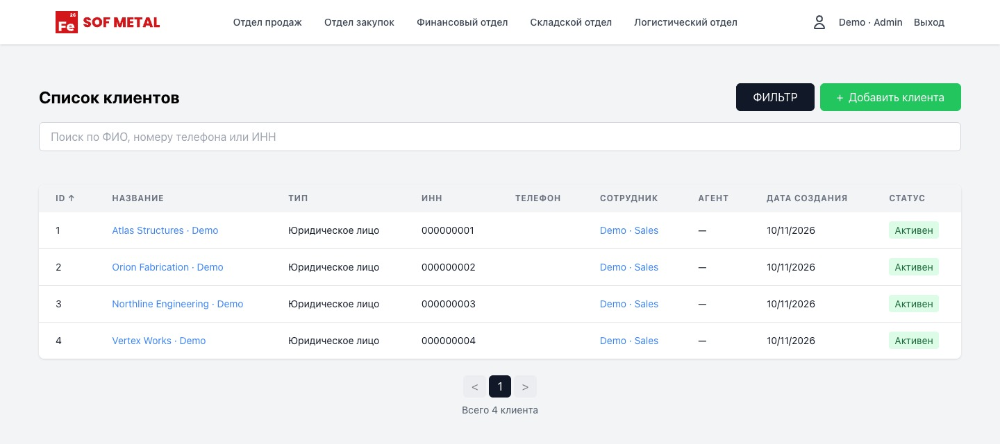

## System design

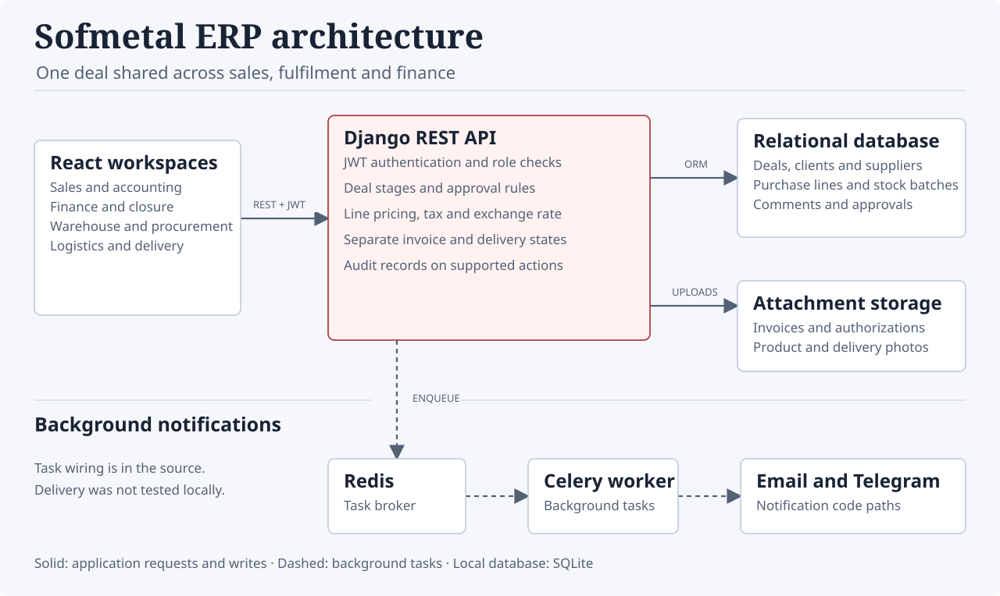

[Full-size SVG](assets/architecture.svg) · [Standalone HTML](assets/architecture.html) · [Editable Excalidraw file](architecture.excalidraw)

The React app shows each employee the queues and actions for their role. Django REST checks the request and applies the deal rules. In the local test, the API blocked a salesperson from approving their own deal. The API also records who confirmed each required department step and when. Documents are stored as typed file attachments, and the database has separate records for comments, change logs and confirmation history.

### Deal lifecycle

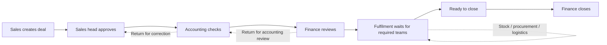

Consider an order with steel sheet in stock and a beam that still needs a supplier. The warehouse can clear the sheet while procurement sources the beam. If the order also requires delivery, the deal waits for logistics. I ran that combination through the local API: the deal stayed in fulfilment after the first two confirmations, moved to **Ready to close** after logistics confirmed, and closed when finance acted.

### Deal and inventory records

| Record | What it stores |
| --- | --- |
| `Deal` | Customer, salesperson, commercial terms, approval stage, invoice, payment and delivery statuses |
| `DealItem` / `DealService` | Quantities, units and agreed prices |
| `Procurement` / `ProcurementItem` / `ProductBatch` | Supplier requests, their lines and the associated inventory batches |
| `Logistics` / `LogisticsCar` | Carrier, route, vehicle, cost and payer |
| `DealDocument` / `DealComment` | Attachments and discussion |
| `DealLog` / `DealConfirmationHistory` | Change and approval history; which records get written depends on the endpoint |

The quantity unit and the price unit are separate on a deal line: the same catalogue supports tonnes, metres, pieces and square metres. Money uses decimal fields. The deal can store the exchange rate and tax settings used for its calculations, and delivery costs and other expenses have their own records.

## Demo

The screenshots use fictional records in the original Russian interface. I ran the 2025 source locally with SQLite. The Celery and Redis configuration is in the source; I did not run external notifications or verify the production setup. The [verification notes](verification.md) cover the workflow test, the legacy test fixtures and what was outside the demo.

[All case studies](../)
