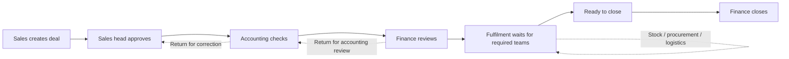

# Sofmetal ERP

### One deal, from sales approval to shipment and financial close

**Custom ERP · Metal distribution and processing · Uzbekistan · 2025 development snapshot**

Sofmetal sells and processes metal products. A single order can combine items already in stock, material that still needs to be sourced, cutting services, and delivery. Each department needs a different piece of that order: sales needs the commercial terms, warehouse needs to know what to release, procurement needs to know what to source, and finance needs to know when the deal can close.

I worked on the Django backend, the deal and approval model, and integration with the React workspaces. I translated client requirements into explicit handoffs between departments, including which team could act, what information it had to supply, and which steps could run in parallel.

[Product walkthrough](#product-walkthrough) · [System design](#system-design) · [Engineering decisions](#engineering-decisions) · [Verification](verification.md)

## Business context

The client described a process spread across spreadsheets, messaging and separate operational systems. A salesperson could have the latest quotation while finance had the payment information and warehouse had the release documents. A manager trying to answer “Can this order ship?” had to reconstruct the state from several places.

The ERP makes the **deal** the shared record. Commercial terms, line items, supporting documents and departmental decisions sit under the same reference. The application derives the fulfilment requirements from the contents of the deal instead of making every order pass through the same checklist.

The company described this system as used by staff in production. The case below is based on a locally restored 2025 source snapshot and fictional data. Production infrastructure, usage counts and savings were not independently measured.

## Product walkthrough

### 1. Sales builds the commercial record

The register groups deals by the next action: sales approval, accounting review, finance review, fulfilment, ready to close or completed. The deal detail shows the client, assigned salesperson, payment terms, item lines and independent payment and delivery statuses. The agreed price is stored per line, so changing the catalogue later does not rewrite the deal.

### 2. Procurement and warehouse handle different kinds of stock

The product catalogue distinguishes physical inventory from supplier sourced items. Physical stock has a warehouse confirmation path. Supplier sourced lines require procurement; the tested mixed order automatically enabled delivery as well.

Procurement has a separate request and line-item model. A request records the selected products, quantities, prices, supplier and payment terms. Inventory batches carry the purchase price and remaining quantity, which supports stock costing. The demo shows a populated request; receiving and inventory reconciliation were not verified end to end.

### 3. Logistics records who moves the material and who pays

On the deal, logistics can see the route, vehicles, cost and payer. The role-specific action area allows the logistics user to submit a delivery confirmation. The deal also carries separate expenses and a comment thread, so an exception can be discussed without changing the sale price.

### 4. Finance sees its own queues

The finance account sees separate queues for financial review, deals ready to close and the archive. Invoice signature, payment, shipment and invoice closure have their own fields alongside the approval stage. The tested API path reached successful completion only after the required operational confirmations and a final finance action.

More product screens

**ERP navigation**

**Procurement register**

**Customer directory**

## System design

[Editable architecture diagram](architecture.excalidraw)

The inspected application is a React and TypeScript frontend with a Django REST backend. The frontend selects workspaces and actions by employee role; the server handles authentication, field restrictions and state transitions. The local snapshot uses SQLite. Celery and Redis configuration and task code are present, but background delivery was not exercised in the demo.

### Deal lifecycle

**The key decision is the fulfilment gate.** The API does not advance a mixed deal after the first department approves. It waits for all teams required for that order. Physical lines, supplier sourced lines and delivery determine the required work. Each confirmation is associated with an employee and timestamp. The tested route held the deal after the warehouse and procurement confirmations, advanced it after logistics, then let finance close it.

### Data model

| Record | Responsibility |
| --- | --- |
| **Deal** | Client, salesperson, commercial terms, workflow stage and separate financial and shipment states |
| **DealItem / DealService** | Quantities, units and negotiated prices; item calculations are kept with the deal |
| **Procurement / ProcurementItem / ProductBatch** | Supplier requests, line-level sourcing and the inventory batch records associated with them |
| **Logistics / LogisticsCar** | Carrier, delivery route, vehicle, cost and responsibility for payment |
| **DealDocument / DealComment** | Typed attachments and operational discussion |
| **DealLog / DealConfirmationHistory** | Models for change tracking and department decisions; coverage varies by endpoint |

## Engineering decisions

**A single stage cannot describe the whole order.** A deal can be commercially approved while documents are unsigned or a shipment is pending. The system keeps the workflow stage separate from invoice, payment and delivery fields. This makes department queues practical without treating “approved” as “paid” or “shipped.”

**Commercial terms belong to the transaction.** Metal can be quoted by tonne, metre, piece or area. A deal line has its own quantity unit, price unit and negotiated price. The local code uses Decimal values for money and includes fields for storing exchange rates and tax settings. Tax branches were read in code; the demo does not establish accounting correctness for every combination. Expenses and logistics costs are displayed separately from the sale lines.

**Permissions are part of the workflow.** Sales managers have their own deal list. Finance, accounting, warehouse and logistics have different update or transition actions. In the smoke test, the viewer was denied a transition and the salesperson could not approve their own deal as sales head. The snapshot has more than one transition implementation; this check establishes behavior for the exercised path and is not an access-control audit.

**Traceability requires more than the latest status.** The backend models comments, documents, employee identity and timestamped confirmations. Its change log and confirmation history provide a place to record review decisions. A future iteration would consolidate transition writes and their audit events into one transactional service, including explicit inventory updates and repeated-action tests.

## What I would improve next

1. **Consolidate transitions and inventory side effects.** The historical code has multiple handlers and some older signal assumptions. A shared transition service would make rejection, retries and concurrent confirmations easier to reason about.
2. **Refresh the test fixtures alongside model changes.** The legacy deal tests still instantiate suppliers without the required type. Replacing stale fixtures and covering mixed stock, pickup, rejection and receiving would make the workflow safer to change.
3. **Verify one full operational path beyond the deal.** Exercise receiving through batch creation and warehouse reconciliation, then validate notification delivery and document generation with synthetic inputs.

The strongest evidence from this review is the complete local deal transition: **sales → sales lead → accounting → finance → warehouse, procurement and logistics → financial close**. Screenshots show the original interface and fictional records. See [verification notes](verification.md) for the exact scope and remaining gaps.

[← All case studies](../)
