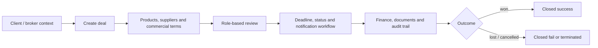
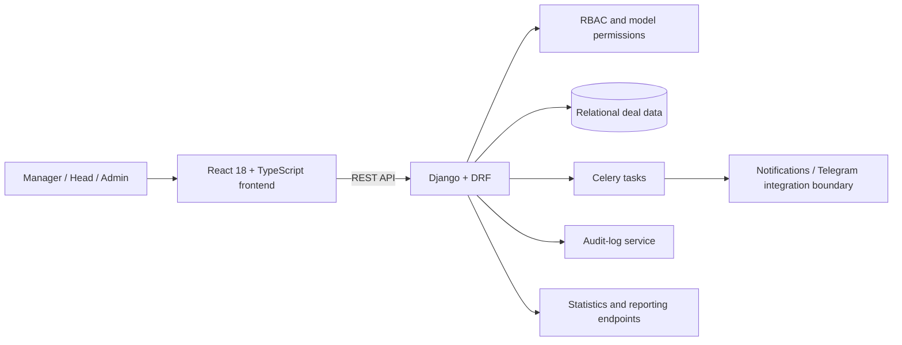

# Tender ERP

> A role-aware operating system for moving a tender from client context to deal execution, finance, documents, deadlines and an auditable outcome.

Tender ERP is a workflow-heavy web application for tender and deal management. The audited frontend and backend repositories show separate but aligned product layers: role-aware navigation and operational screens in React, backed by Django REST modules for clients, companies, brokers, deals, line items, finance, documents, reporting, audit events and notifications.

## Business workflow

## System design

## Observed implementation evidence

- Backend modules include users, permissions, clients, brokers, companies, markets, deals, deal items, deal documents, finance entries, regions/districts, audit logs and Telegram-related services.
- Migration history and tests cover status transitions, cancellations, deadlines, RBAC, notifications, phone numbers, filtering and statistics.
- The frontend provides authenticated role-aware routes for dashboard, deals, clients, users, companies, brokers, statistics, notifications, audit log, profile and settings.
- The current frontend local service layer is mock-backed, which is useful for a safe visual demo. Backend integration is separately documented in the source repositories.

## Visual evidence status

We will capture screenshots from the safe local mock demo, using fictional deals only. Existing backend media files are not included: they may contain client documents and are outside the public portfolio boundary.

Planned screenshots:

1. role-aware dashboard and deal overview;
2. deal lifecycle with status transitions and deadline context;
3. finance/documents/audit evidence from synthetic data;
4. statistics or reporting view.

## Confidentiality note

The production source code, client records, commercial terms, uploaded documents and notification configuration remain private. This case study explains the system without exposing them.

## Contribution note

The final public wording of Shamshodbek's exact delivery scope will be added after factual review against the repositories and project context.
