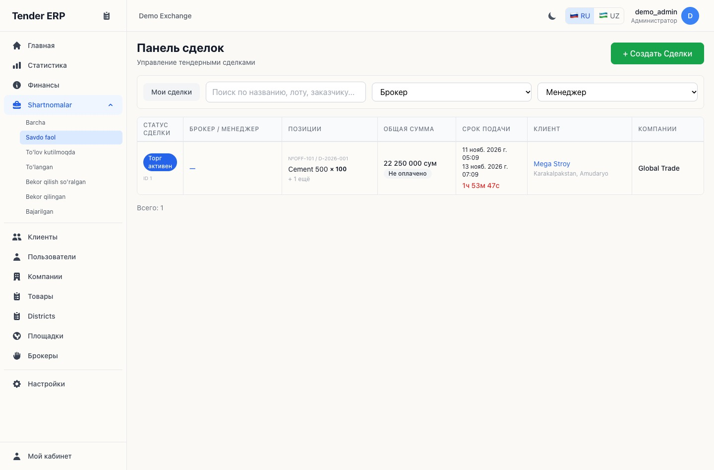
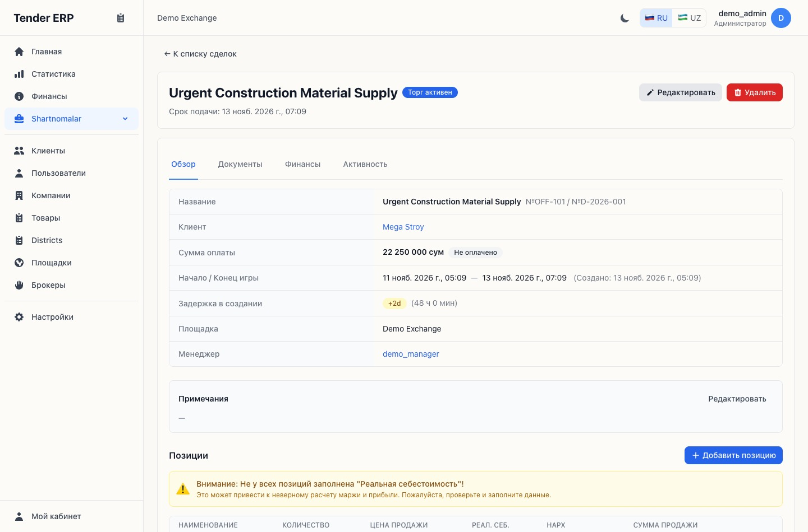
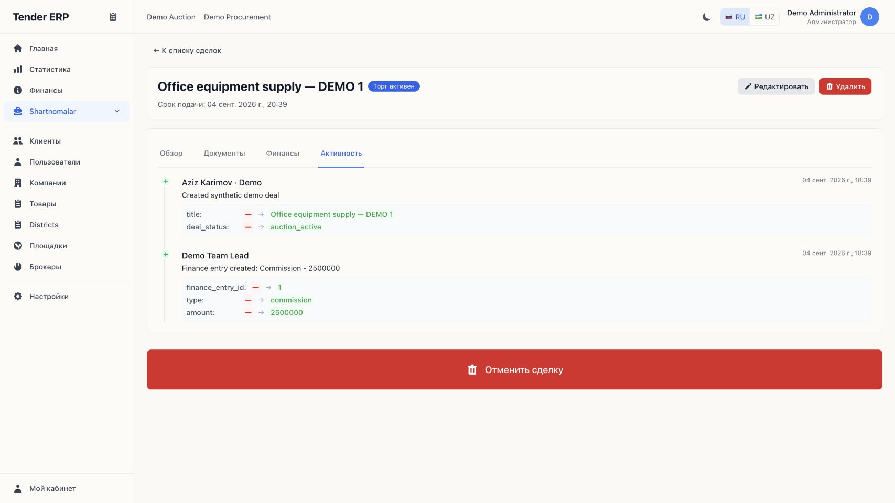
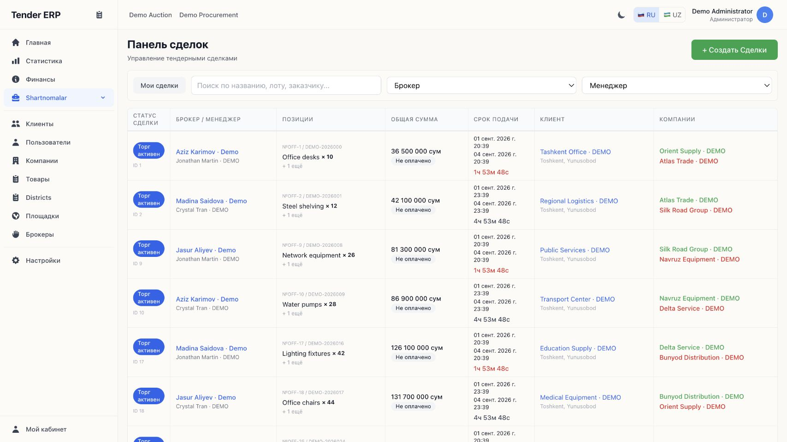
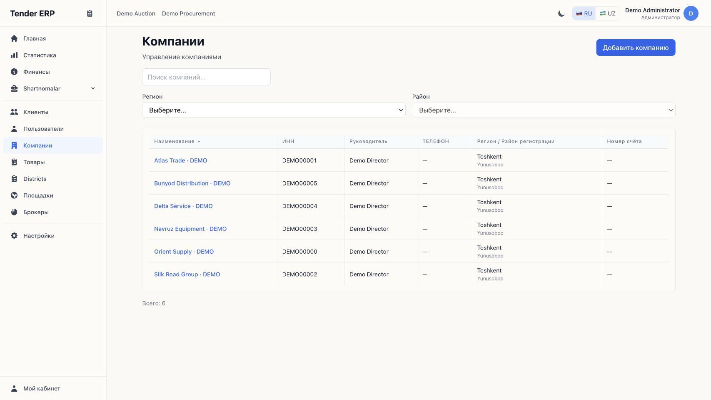
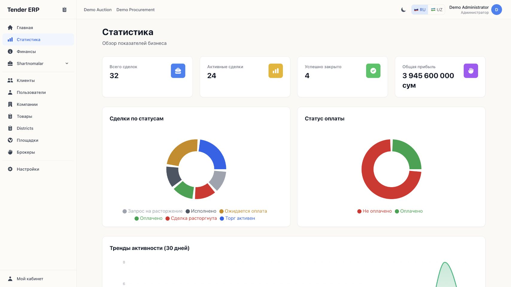
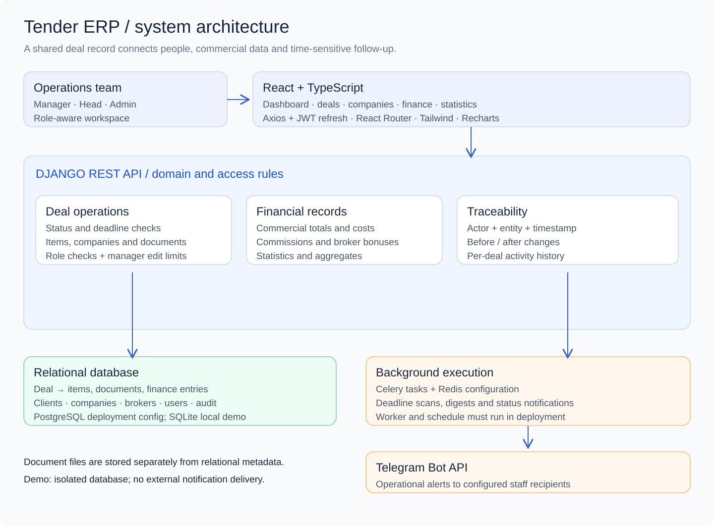
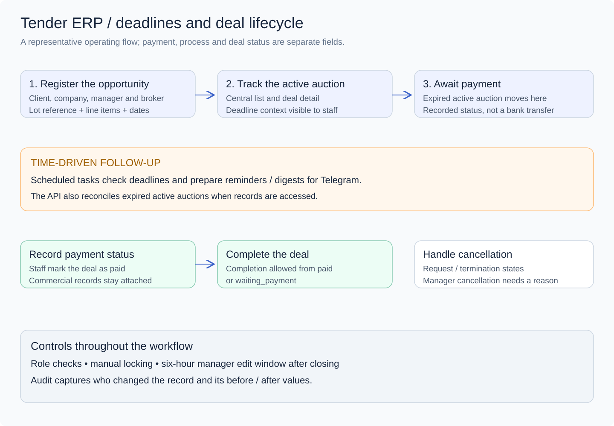

# Tender ERP

I built Tender ERP for a team managing public procurement opportunities across several companies. They used spreadsheets and Telegram to track bids. The ERP gives each deal one record for the lot, deadline, manager, companies, documents and payment state.

[System design](#system-design) · [Verification](./verification.md)

## Managing a deal

A manager opens a lot and links the client, marketplace, broker and participating companies. The company submitting an offer can differ from the company that wins. The deal keeps the item lines, commercial terms and documents together.

Auction stage, internal progress and payment state are separate fields. Once an active auction ends, the API can move it to awaiting payment when it next reads the deal. Scheduled tasks check deadlines too. A cancellation has a reason and follows the relevant role rules. The system records payment information for staff; it neither charges the client nor bids on the procurement site.

## What the team can review

The activity tab shows who changed a deal and what changed. The company directory avoids re-entering the same legal entities. The reporting view shows status and activity by manager, while Telegram tasks are configured to send reminders and updates.

Full deal register, company directory and reporting

## System design

[Editable diagram](./system-design.excalidraw)

React and TypeScript provide the workspace. The Django REST API uses JWT access and refresh tokens and checks Manager, Head and Admin permissions. The deal links to line items, documents, finance entries and audit events. The deployment configuration uses PostgreSQL, Celery and Redis; the isolated demo uses SQLite and no live Telegram credentials.

[Editable diagram](./deal-workflow.excalidraw)

The diagram shows a typical path. The API also allows a deal to be completed directly from awaiting payment in the supported flow, so a separate paid state is not a universal prerequisite. See [verification notes](./verification.md) for the role, status and audit checks.

[All case studies](../)
