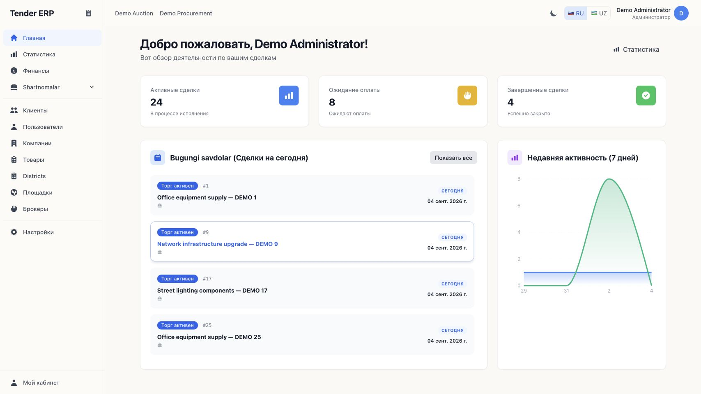
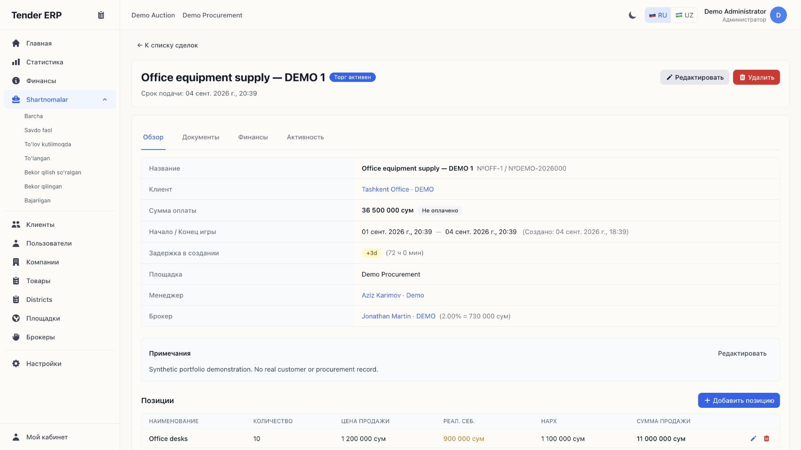

# Tender ERP

### Keeping tender operations, deadlines and accountability in one workspace

**Production internal ERP · Uzbekistan · Private client · React + Django REST**

Tender brokerage is a coordination problem: a team works across multiple companies, clients and auction lots, while each opportunity has its own deadline, commercial terms and responsible person. When those details live across Excel files and Telegram conversations, it becomes difficult to see what needs attention—and easy to lose track of a deal at the wrong moment.

I developed Tender ERP to centralize that workflow: register an opportunity, connect the people and companies involved, track its commercial details, follow its status, and keep a history of changes. Telegram notifications bring operational updates into the messenger the team already uses.

*The application is used by staff in production, as reported by the project author. Every screenshot here comes from a separate local installation with fictional records. Displayed counts and amounts are demonstration values, not production metrics.*

## The business problem

The client operates between businesses and public procurement opportunities in Uzbekistan. Employees coordinate multiple legal entities and lots, with time-sensitive auction activity and follow-up after the auction ends. Their existing workflow combined spreadsheets, Telegram and other messages, without one shared view of ownership, deadlines or the latest state of a deal.

The project therefore needed more than a contact database. It needed a common operational record that connected a lot to its manager, broker, client, participating companies, items, financial entries and documents. A manager should be able to resume work from that record; a team lead should be able to review progress without reconstructing it from conversations.

## My contribution

My work centered on developing the ERP workflow and its Telegram notification integration: translating the client's spreadsheet-and-messenger process into structured records, explicit statuses, staff responsibilities and a reviewable change history. The implementation combines an authenticated web workspace with a REST backend, relational business data and background notification tasks.

The case focuses on the resulting system and its engineering decisions. The production code and client identity remain private.

## Product walkthrough

### 1. A shared deal register

The register puts opportunities in one place, with status, company, responsible manager, broker and timing information alongside commercial totals. Search, filters and personal-deal views help staff narrow the working queue. Status-specific navigation makes ongoing work and completed outcomes accessible from the same workspace.

### 2. One record for the operational context

A deal brings together the lot reference, auction dates, client, companies, manager, broker, notes and product lines. Overview, documents, finance and activity are separate tabs within that record, keeping related work attached to the same opportunity.

The model separates **deal status**, **payment status** and **process status**. This matters because progress through an auction, a recorded payment and completion of the operational work are different facts.

### 3. Reusable company records

Companies, clients, brokers, products and geographic reference data have their own records. Deals reference those entities rather than treating every opportunity as an unrelated spreadsheet row. Company records include identifiers and regional context; several deals can share the same organization.

### 4. Reviewable activity

Audit entries connect a change to an entity, actor and timestamp, with before/after values where recorded. The per-deal activity view makes it possible to inspect how a record changed alongside its current state.

During this portfolio run, the activity screen exposed a small integration bug: the backend declared an audit filter but did not activate its filtering backend, so a deal could display unrelated history. I corrected the view configuration and verified that the selected deal now returns only its own events.

### 5. Operational reporting

Statistics summarize deal statuses, payment status, activity over time and manager volume. These views give the team an overview built from the same records used for daily work. Commercial amounts shown here are synthetic; the screenshots demonstrate the reporting interface, not independently verified business results.

## Main capabilities

| Area | Implemented capability | Why it matters |
| --- | --- | --- |
| Deal lifecycle | Active auction, awaiting payment, paid, cancellation request, terminated and completed states | Makes the current stage explicit |
| Deadline handling | Auction dates, time-based status reconciliation and scheduled reminder tasks | Supports follow-up around time-sensitive opportunities |
| Commercial detail | Product lines, quantities, prices, costs and financial entries | Keeps the commercial context attached to the deal |
| Relationships | Clients, companies, brokers, managers and procurement platforms | Connects the participants in each opportunity |
| Documents | Deal-linked files with type, version and uploader metadata | Preserves document context |
| Access control | Manager, Head and Admin roles, model permissions and manager edit restrictions | Supports different operational responsibilities |
| Audit | Actor, entity, action, timestamp and before/after data | Makes changes reviewable |
| Telegram | Notification services and tasks for deal events, reminders and digests | Brings updates into the team's existing communication channel |
| Reporting | Status distributions, activity trends and manager volume | Supports operational oversight |

## System design

The system uses a React client and a modular Django REST backend. The API handles authentication, validation, business rules and persistence; the frontend provides the operational workspace. Celery tasks and Redis configuration support background work, while Telegram is an external delivery channel.

[Download the editable architecture](./system-design.excalidraw) · [Open the full-size preview](./system-design-preview.svg)

The central relational entity is the **deal**. It connects reference entities—companies, client, manager, broker and market—to dependent records such as items, documents and finance entries. Audit records reference the affected entity and retain change information. Document metadata is relational; uploaded file content is stored separately.

The frontend uses Axios with JWT authentication and token refresh. Backend viewsets and serializers provide the API boundary, with explicit access and state checks in the relevant operations. The deployment configuration supports PostgreSQL; this portfolio installation used SQLite. Live Telegram delivery and a deployed worker schedule were not exercised in the demo.

## Deadline and status workflow

[Download the editable workflow](./deal-workflow.excalidraw) · [Open the full-size preview](./deal-workflow-preview.svg)

An active auction becomes an awaiting-payment deal after its end time. The code provides time-based reconciliation when records are accessed as well as background deadline checks. Notification tasks cover reminders, status events and digests.

The diagram shows a representative operating flow, not an exhaustive state-transition specification. For example, completion is allowed from either `waiting_payment` or `paid`; it does not universally require a separate paid step. A manager must provide a reason when terminating a deal. Manager edits are also subject to manual locking and a six-hour window after closing in the relevant validation path, while Head/Admin operations have different permissions.

Payment status and finance entries are internal business records. This case does not claim payment processing or automatic bidding on government procurement platforms.

## Technical stack

| Layer | Technology |
| --- | --- |
| Web application | React 18, TypeScript, React Router 6 |
| UI and reporting | Tailwind CSS, Recharts, Uzbek/Russian interface |
| API client | Axios, JWT access/refresh handling |
| Backend | Python, Django 5.0.2, Django REST Framework |
| API tooling | SimpleJWT, django-filter, drf-spectacular / OpenAPI |
| Persistence | PostgreSQL deployment configuration; SQLite for this isolated demo |
| Background work | Celery, Redis configuration, Telegram Bot API |
| Verification | Django/DRF tests and browser checks against the local API |

## Engineering challenges and review

**Turning a flexible process into explicit state.** A spreadsheet permits ambiguous combinations of status, payment and progress. The ERP gives these concepts separate fields and validates important operations, including completion, cancellation and manager editing after closure. The challenge is preserving legitimate business exceptions without making every combination valid.

**Treating time as part of the workflow.** An auction deadline changes what a record means even when nobody edits it. That is why the implementation includes both deadline tasks and reconciliation on API access. The remaining operational responsibility is to run and monitor the worker schedule; a task definition alone is not evidence that reminders are being delivered.

**Keeping oversight close to everyday work.** The useful audit interface is the history of the record a person is reviewing. The filtering issue found during this demo reinforced that endpoint-level correctness matters as much as having an audit model. A history table is only helpful when the interface retrieves the right history.

**Connecting notifications to business records.** Telegram makes updates convenient, but the ERP remains the place to inspect the current deal and its history. A future reliability improvement would be durable delivery tracking and idempotency around notifications, so failed or repeated task execution can be investigated explicitly. This case does not claim exactly-once delivery.

The engineering takeaway is that an internal ERP earns its usefulness through connected records, explicit responsibility and reliable follow-up. The technical work is not just building forms: it is representing how the team makes decisions, hands work over and explains what happened afterward.

## Evidence and scope

For this case, the actual React frontend was run against the actual Django API in an isolated local environment. The demo contains **32 fictional deals, 64 line items, 6 companies and 12 clients**, with varied statuses and managers. None of these counts describe production scale.

**25 targeted automated tests passed** across authentication, status transitions, cancellation and RBAC. A separate authenticated API check verified the corrected audit filtering, followed by browser verification. Six screenshots and two validated, editable Excalidraw diagrams are included.

See [verification notes](./verification.md) for the exact scope and limitations. Production source, credentials, customer data and uploaded client documents are not distributed in this repository.

---

[← All case studies](../README.md) · [GitHub](https://github.com/Rokki-Khazratov) · [LinkedIn](https://www.linkedin.com/in/bek-khazratov-751954225/)
