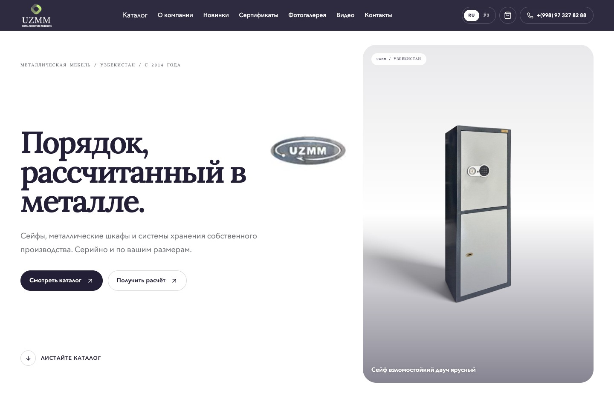
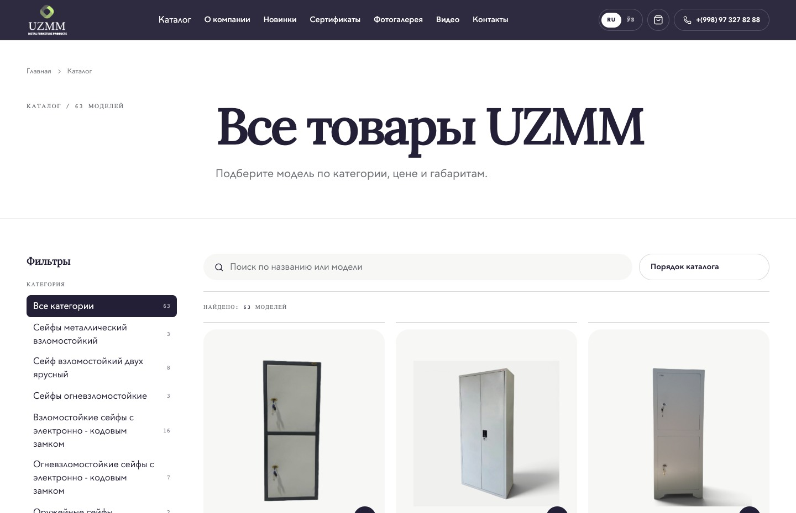
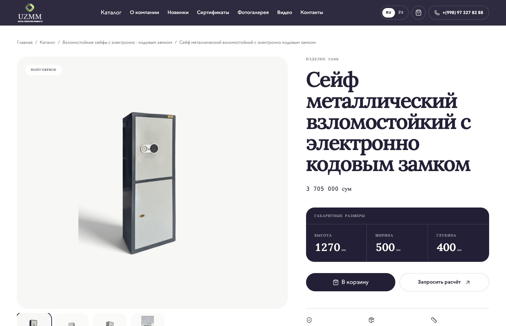
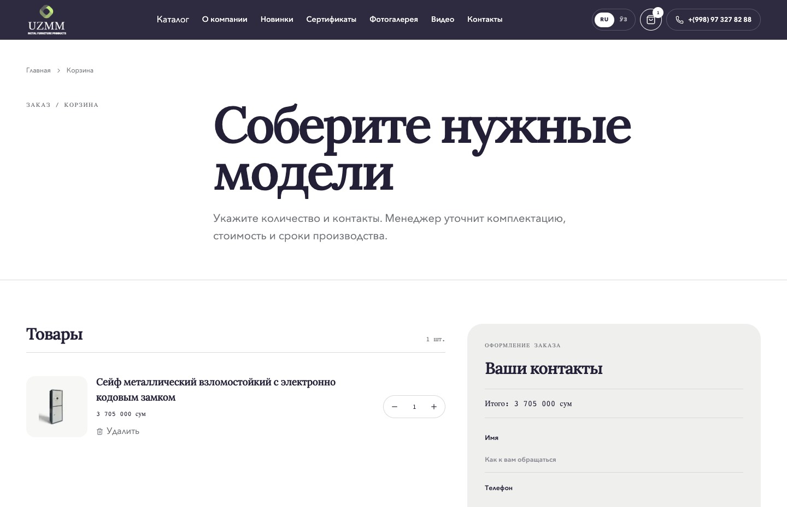
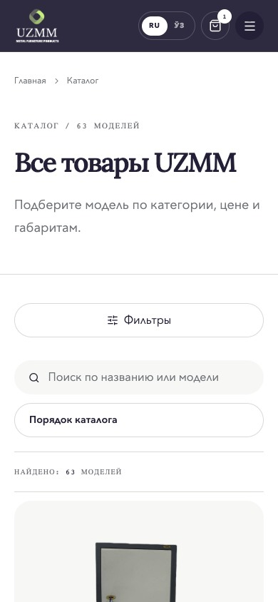
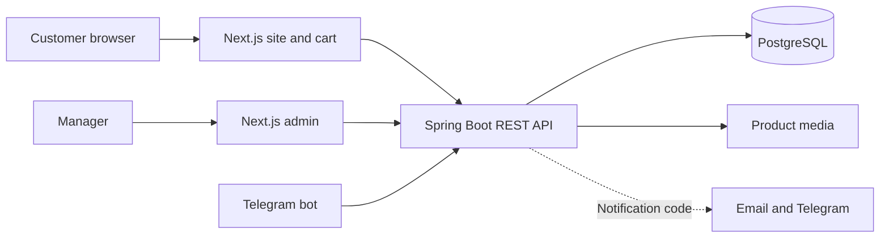

# UZMM

[Live site](https://uzmm.uz/) · [Catalog](https://uzmm.uz/catalog) · [Cart](https://uzmm.uz/cart)

UZMM makes metal furniture and storage equipment in Uzbekistan. The site lets customers compare models, check dimensions and prices, and send a list of products to a manager. The manager confirms the configuration, price and lead time. The site does not take payment.

## From catalogue to order request

Customers can browse the [catalogue](https://uzmm.uz/catalog) in Russian or Uzbek Cyrillic. A [product page](https://uzmm.uz/catalog/sejfy-s-kodovym-zamkom/sejf-vzlomostojkie-2) puts the photos, measurements, price and specifications together. If a customer needs a custom size, the quote form gives them a separate place to describe it.

The cart is saved in the browser. A customer can change quantities and see the total before sending a request. I opened the live site in Chrome, added one product and confirmed that it appeared in the cart. I stopped before submitting contact details.

Mobile catalogue

## System design

The site and admin are in the same Next.js application. The Java backend owns the catalogue and order records. The public endpoints serve categories, products, prices and attributes. The admin endpoints let staff edit the catalogue and handle orders and inquiries without rebuilding the site.

The Spring service writes the order and its lines in a transaction. The API looks up the product and records the amount with the order line. A quote request is a separate record and starts in the new state. Flyway owns schema changes. The Next.js catalogue reads from Spring Boot; the browser sends orders and quote requests through Next.js route handlers. The repository also contains a Telegram bot that uses the catalogue and order API, plus a Compose deployment with Caddy, PostgreSQL and Redis.

## What the demo covers

A separate local Spring Boot and PostgreSQL run imported **54 products in 14 categories** from the repository fixtures. A test order and quote request both started in the new state, and the order line kept the catalogue price at submission. These are local import counts, not a count of the live catalogue.

The public pages and cart were checked on [uzmm.uz](https://uzmm.uz/) on 13 November 2026. Every screenshot above comes from that domain. The admin and bot flows are described from local source; production admin access and real order or notification delivery were outside the walkthrough.

[All case studies](../)
